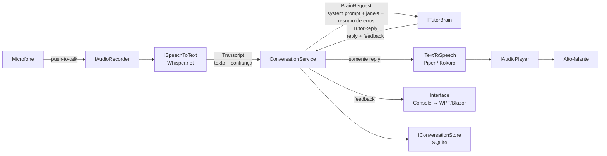
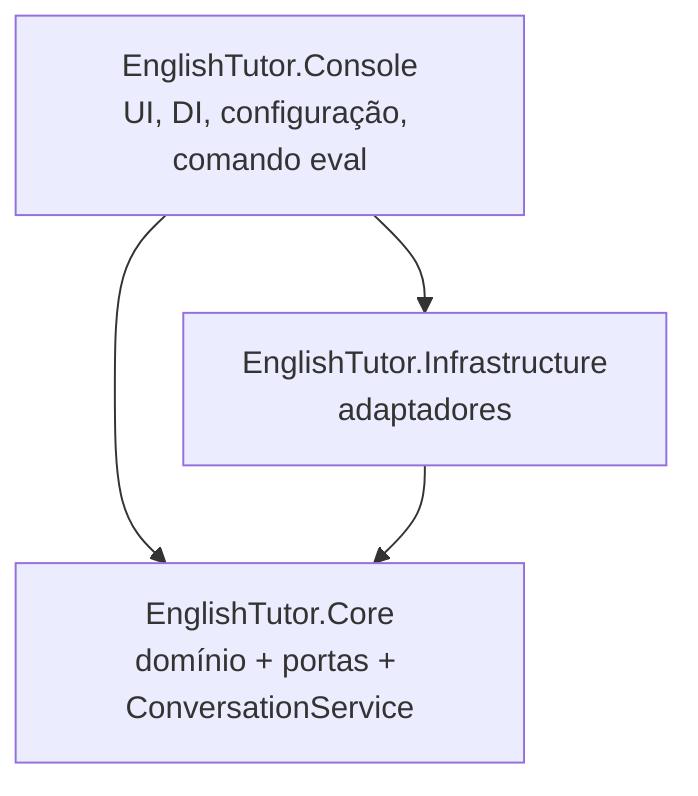

# ARCHITECTURE.md — EnglishTutor

> Fonte única da verdade da arquitetura. Qualquer mudança estrutural exige um ADR em `docs/adr/` **e** atualização deste arquivo no mesmo PR.

## 1. Visão geral



Tudo roda localmente, exceto o provedor `ClaudeCode`, que chama o processo `claude` usando a assinatura do usuário (sem API key).

## 2. Camadas e regra de dependência



| Projeto | Responsabilidade | Pode depender de |
|---|---|---|
| `EnglishTutor.Core` | Modelos de domínio, interfaces (portas), `ConversationService`, montagem de mensagens, regras de negócio | BCL, `Microsoft.Extensions.*.Abstractions` (Logging, DependencyInjection), `Microsoft.Extensions.Options` |
| `EnglishTutor.Infrastructure` | Implementações das portas: STT, cérebros, parser, TTS, áudio, persistência | Core + pacotes externos (Whisper.net, NAudio, EF Core/Dapper, Microsoft.Extensions.AI, ...) |
| `EnglishTutor.Console` | Composition root: DI, Options, Serilog, loop de interação, comando `eval` | Core + Infrastructure |
| (futuro) `EnglishTutor.Wpf` / `EnglishTutor.Web` | Outra interface sobre o mesmo Core | Core + Infrastructure |

Regras:

- **R1** — `Core` nunca referencia `Infrastructure`, `Console` nem pacotes de terceiros.
- **R2** — A interface (console hoje, WPF/Blazor amanhã) só conversa com o `ConversationService` e com eventos/DTOs do Core. Trocar a UI não pode exigir mudança no Core.
- **R3** — Cada adaptador implementa exatamente uma porta e é registrado no DI por configuração.
- **R4** — Nenhuma classe de `Infrastructure` contém regra de negócio (ex.: quantos turnos manter, quando refazer a pergunta). Isso mora no Core.

## 3. Estrutura de pastas

```
src/
  EnglishTutor.Core/
    Conversation/      ConversationService, ConversationWindow, ConversationTurn, ConversationTurnResult,
                       ConversationMessages, ConversationOptions, ConversationOptionsValidator, ConversationLog,
                       ITutorPromptSource, TurnMessageBuilder, TutorMode, LocalCommandParser, LocalCommand, LocalCommands
    Brain/             ITutorBrain, BrainRequest, BrainMessage, BrainRole, TutorReply, Correction, TutorReplyParseResult,
                       TutorReplyRejection, TutorReplyRejections, TutorReplyValidator, ReplySentences, FeedbackFormatter,
                       BrainException, BrainErrorKind, BrainOptions, BrainOptionsValidator, BrainProviders
    Speech/            ISpeechToText, Transcript, TranscribedWord, ITextToSpeech
    Audio/             IAudioRecorder, IAudioPlayer, AudioClip
    Persistence/       IConversationStore, SessionRecord, TurnRecord, RecurringError
  EnglishTutor.Infrastructure/
    Brain/             ClaudeCodeTutorBrain, ClaudeCodeOptions, ClaudeCodeOptionsValidator, ClaudeCodeOutput, ClaudeCodeFailures,
                       ClaudeCodePromptRenderer, ClaudeCodeLog, BrainOutputModes, TutorReplySchema,
                       FileTutorPromptSource, PromptFiles, ClaudeCodeStreamingBrain, OllamaTutorBrain, OllamaOptions,
                       OllamaOptionsValidator, OllamaFailures, OllamaChatClients, OllamaLog,
                       TutorReplyParser, BrainFactory, FallbackTutorBrain
    Processes/         IProcessRunner, ProcessRequest, ProcessResult, ProcessRunner
    DependencyInjection/ InfrastructureServiceCollectionExtensions
    Stt/               WhisperNetSpeechToText, WhisperModelDownloader
    Tts/               PiperTextToSpeech, KokoroHttpTextToSpeech
    Audio/             NAudioRecorder, NAudioPlayer
    Persistence/       SqliteConversationStore
  EnglishTutor.Console/
    Program.cs, EnglishTutorApp, appsettings.json, Commands/ (chat, eval), Ui/ (ChatSession, ConversationInputHandler), Logging/; prompts/ copiado para a saída
prompts/
  tutor.md             system prompt único (regras de conteúdo)
  format.json.md       instrução de formato quando o provedor usa saída estruturada
  format.tags.md       instrução de formato com <reply>/<feedback>
eval/
  golden-set.json
tests/
  EnglishTutor.Core.Tests/
  EnglishTutor.Infrastructure.Tests/   (inclui Fixtures/ e Contract/)
  EnglishTutor.Console.Tests/          (casca do console, em processo com TextReader/TextWriter)
```

## 4. Portas do Core (contratos)

Todas as operações assíncronas recebem `CancellationToken`.

```csharp
public interface ISpeechToText
{
    Task<Transcript> TranscribeAsync(AudioClip audio, CancellationToken ct);
}
public sealed record Transcript(string Text, IReadOnlyList<TranscribedWord> Words);
public sealed record TranscribedWord(string Word, float Confidence);

public interface ITutorBrain
{
    string Name { get; }
    Task<TutorReply> SendAsync(BrainRequest request, CancellationToken ct);
}
public sealed record BrainRequest(string SystemPrompt, IReadOnlyList<BrainMessage> Messages, string? SessionHint);
public sealed record BrainMessage(BrainRole Role, string Content);
public enum BrainRole { User, Assistant }   // o system prompt vai em BrainRequest.SystemPrompt
public enum BrainErrorKind { CliNotFound, NotAuthenticated, UsageLimitReached, Timeout, InvalidOutput, Unknown }
public sealed class BrainException : Exception { /* Kind; Rejection e RawText só via BrainException.InvalidOutput(rejection, rawText) (ADR-006) */ }
public interface ITutorPromptSource { Task<string> GetSystemPromptAsync(CancellationToken ct); }   // conteúdo de prompts/tutor.md
public sealed record TutorReply(string Reply, IReadOnlyList<Correction> Corrections,
                                string? Pronunciation, string? Vocabulary, string? Praise,
                                bool IsRawFallback, string RawText);
public sealed record Correction(string Original, string Corrected, string Explanation);

public interface ITextToSpeech
{
    Task<AudioClip> SynthesizeAsync(string text, float speed, CancellationToken ct);
}
public interface IAudioRecorder { Task<AudioClip> RecordUntilReleasedAsync(CancellationToken ct); }
public interface IAudioPlayer   { Task PlayAsync(AudioClip clip, CancellationToken ct); }

public interface IConversationStore { /* sessões, turnos, erros recorrentes, palavras de baixa confiança */ }
```

Os nomes acima são o alvo; o Planejador de cada US pode refiná-los, desde que registre a mudança aqui.

## 5. ConversationService — dono do histórico

O histórico **pertence à aplicação**, não ao provedor (RN-BRAIN01).

A cada turno o `ConversationService`:

1. Recebe a fala do aluno (`Transcript`, ou texto digitado na fase de texto). Texto em branco não chega ao cérebro: o resultado é um aviso local (RN-CONV05).
2. Monta a mensagem do turno (RN-CONV02):
   ```
   Student said (transcribed): "<texto>"
   Low-confidence words (possible pronunciation issues): ["word1", "word2"]
   Mode: <free-conversation | job-interview | listening-practice>
   ```
3. Monta o `BrainRequest`: system prompt (`tutor.md`, via `ITutorPromptSource`; a instrução de formato do provedor é anexada pelo adaptador, ADR-002) + resumo dos erros recorrentes + últimos N turnos (`Conversation:MaxTurnsInWindow`; o professor entra com o `RawText` da resposta) + mensagem atual.
4. Chama `ITutorBrain.SendAsync`. O cérebro devolve um `TutorReply` já validado pelo parser. Se o parser rejeitar, o adaptador lança `BrainException.InvalidOutput(rejection, rawText)` (ADR-005, ADR-006).
5. Em `InvalidOutput`, o serviço faz **uma** nova tentativa: as mesmas mensagens + a resposta rejeitada (`Assistant`) + a instrução de correção com `TutorReplyRejection.Message` (`User`). Se falhar de novo, usa `TutorReply.RawFallback` (`IsRawFallback = true`, sem feedback) (RN-BRAIN04). A tentativa rejeitada e a correção não entram no histórico (ADR-006).
6. Envia **apenas** `Reply` ao TTS (RN-TTS01); o feedback vai só para a tela.
7. Persiste o turno e atualiza erros recorrentes / palavras de baixa confiança.

Provedores com estado (Claude Code via `--resume`) guardam o identificador da sessão no próprio adaptador e só o reaproveitam quando o `BrainRequest` tem o mesmo system prompt, repete exatamente as mensagens que a sessão já conhece e acrescenta uma única mensagem do aluno; em qualquer outro caso enviam a janela completa numa sessão nova (ADR-007). `BrainRequest.SessionHint` fica reservado, e o `ConversationService` o envia `null`.

## 6. Cérebro plugável

```mermaid
classDiagram
    class ITutorBrain { <<interface>> +Name +SendAsync(BrainRequest, ct) TutorReply }
    ITutorBrain <|.. ClaudeCodeTutorBrain : processo por chamada
    ITutorBrain <|.. ClaudeCodeStreamingBrain : processo persistente stream-json
    ITutorBrain <|.. OllamaTutorBrain : HTTP via IChatClient
    ITutorBrain <|.. FallbackTutorBrain : decorator primário → secundário
    ClaudeCodeTutorBrain --> TutorReplyParser
    OllamaTutorBrain --> TutorReplyParser
    BrainFactory --> ITutorBrain : cria conforme Brain:Provider
```

### 6.1 Configuração

```json
"Brain": {
  "Provider": "ClaudeCode",
  "FallbackProvider": "Ollama",
  "ClaudeCode": {
    "ExecutablePath": "claude",
    "Model": "haiku",
    "WorkingDirectory": "%LOCALAPPDATA%/EnglishTutor/brain",
    "TimeoutSeconds": 60,
    "UseResume": true,
    "OutputMode": "JsonSchema"
  },
  "Ollama": {
    "Endpoint": "http://localhost:11434",
    "Model": "qwen2.5:14b-instruct-q4_K_M",
    "Temperature": 0.6,
    "TimeoutSeconds": 60,
    "OutputMode": "JsonSchema"
  }
}
```

Validação das Options na inicialização (`ValidateOnStart`).

### 6.2 Contrato de saída (ver ADR-002)

- Forma canônica: objeto JSON `{ reply, corrections[{original, corrected, explanation}], pronunciation, vocabulary, praise }`.
- `ClaudeCode` usa `--json-schema` e lê `structured_output`; `Ollama` usa `format` com o mesmo JSON Schema.
- `TutorReplyParser` é **único**: aceita o JSON canônico e, como alternativa, o formato com tags `<reply>…</reply><feedback>…</feedback>` (texto cru, modelos menores, `OutputMode: Tags`).
- As regras de conteúdo verificáveis (reply não vazio e com exatamente uma pergunta, isto é, uma única frase terminada em `?`, em qualquer posição, com as frases separadas por `ReplySentences`; no máximo 2 correções; correção com `original` e `corrected`) moram no Core (`TutorReplyValidator`, R4); o `TutorReplyParser` cuida só do formato e delega a elas (ADR-005). Toda rejeição traz um `Reason` curto e uma `Message` que diz o que faltou e o que se espera, usada na retentativa da RN-BRAIN04.

### 6.3 Provedor Claude Code (processo)

Invocação (por turno, Fase 2):

```
claude -p
  --output-format json
  --json-schema <schema>                  (OutputMode=JsonSchema; TutorReplySchema)
  --system-prompt-file <arquivo temporário com BrainRequest.SystemPrompt = prompts/tutor.md>
  --append-system-prompt-file prompts/format.json.md   (prompts/format.tags.md com OutputMode=Tags)
  --tools ""                              (nenhuma ferramenta embutida)
  --disallowedTools "mcp__*"
  --strict-mcp-config
  --permission-mode dontAsk
  --model <Brain:ClaudeCode:Model>
  [--resume <session_id>]
```

- `WorkingDirectory` é uma pasta vazia dedicada, para não carregar `CLAUDE.md`, hooks ou MCP de outros projetos.
- **Nunca** `--bare` (exige `ANTHROPIC_API_KEY`, não usa a assinatura).
- Prompt enviado via stdin (evita limites e escaping de linha de comando no Windows): sem `--resume`, as mensagens do `BrainRequest` num texto único (`ClaudeCodePromptRenderer`); com `--resume`, só a mensagem nova (ADR-007). O arquivo temporário do system prompt fica fora da pasta de trabalho e é apagado ao fim da chamada.
- Saída: `structured_output` (JsonSchema) ou `result` (Tags) vai para o `TutorReplyParser`; o `session_id` fica no adaptador (ADR-007). Falhas viram `BrainException` classificada pelo adaptador (ADR-008): executável não encontrado → `CliNotFound`; texto de autenticação ou de limite de uso no `result` de erro ou no stderr → `NotAuthenticated` ou `UsageLimitReached`; `TimeoutSeconds` estourado → `Timeout`, com o processo encerrado junto com a árvore; o resto → `Unknown` com o detalhe. A mensagem da exceção é o texto mostrado ao aluno (o que houve e o que fazer); o console a mostra na saída de erro e a sessão continua.
- Erros mapeados para `BrainException` com `BrainErrorKind`: `CliNotFound`, `NotAuthenticated`, `UsageLimitReached`, `Timeout`, `InvalidOutput`, `Unknown`.
- `UsageLimitReached` (e, se configurado, `CliNotFound`/`NotAuthenticated`) aciona o `FallbackTutorBrain`.

### 6.4 Provedor Ollama (HTTP)

- Via `Microsoft.Extensions.AI` (`IChatClient`) com o cliente `OllamaSharp` (`OllamaApiClient`, ADR-009); histórico montado pela aplicação a cada chamada (sem estado, RN-BRAIN01).
- Mensagem `system` = `BrainRequest.SystemPrompt` + instrução de formato do modo (`prompts/format.json.md` ou `format.tags.md`, ADR-002). `OutputMode=JsonSchema` envia `format` com o `TutorReplySchema`; `Tags` não envia `format`. Modelo e temperatura vêm de `Brain:Ollama`.
- Falhas viram `BrainException` classificada pelo adaptador (ADR-009): servidor sem resposta → `Unknown` com "Ollama is not running ..."; modelo ausente → `Unknown` com `ollama pull <modelo>`; `TimeoutSeconds` estourado → `Timeout`, com a requisição cancelada. O console mostra a mensagem como nas falhas do Claude Code.
- O mesmo `IChatClient` servirá de base para o futuro provedor `AnthropicApi`.

## 7. Voz

- STT: Whisper.net; runtime **CUDA** (GPU NVIDIA RTX 4070 Ti SUPER, 16 GB), fallback Vulkan e depois CPU. Modelo padrão `large-v3-turbo`, baixado na primeira execução para `models/` (ignorado pelo Git). Confiança por palavra a partir das probabilidades de token.
- TTS: Piper (executável, opção inicial — sem Python) e Kokoro (alternativa). Velocidade configurável (`Tts:Speed`). Fala apenas o `Reply`.
- Áudio: NAudio (captura 16 kHz mono para o Whisper; reprodução).

### Orçamento de VRAM (alvo, a medir)

| Componente | Estimativa |
|---|---|
| Whisper large-v3-turbo (CUDA) | ~2–3 GB |
| Whisper small/base (modo "LLM local") | <1 GB |
| Piper / Kokoro | <0,5 GB |
| LLM local 14B Q4 | ~9–10 GB |
| LLM local 7–8B Q4 | ~5–6 GB |

## 8. Persistência

SQLite em `%LOCALAPPDATA%/EnglishTutor/tutor.db`: `Sessions`, `Turns` (fala transcrita, resposta, feedback, provedor, latência), `RecurringErrors` (padrão → contagem → último exemplo), `LowConfidenceWords`. No início de cada sessão o resumo dos erros mais frequentes entra no `BrainRequest` (RN-CONV04).

## 9. Transversais

- DI com `Microsoft.Extensions.Hosting`; Options Pattern com validação.
- Logs estruturados com Serilog em arquivo (`logs/`, formato JSON compacto), incluindo latência por etapa (STT, cérebro, TTS). O console é reservado à interface do aluno (ADR-004).
- `CancellationToken` em todo fluxo assíncrono; Ctrl+C encerra a sessão de forma limpa.
- `TreatWarningsAsErrors`, `Nullable` habilitado, analisadores .NET.

## 10. Estratégia de testes

| Tipo | Onde | Ferramentas |
|---|---|---|
| Unidade (TDD) | `EnglishTutor.Core.Tests` | xUnit, FluentAssertions, NSubstitute; fakes de todas as portas |
| Parser / fixtures | `EnglishTutor.Infrastructure.Tests` | saídas reais gravadas em `Fixtures/` (Claude Code JSON, Ollama JSON) a partir da US-004; até lá (US-002), exemplos da spec em `Fixtures/TutorReply/` |
| Contrato | `Infrastructure.Tests/Contract/TutorBrainContractTests` (classe abstrata) | uma subclasse por provedor; fake de processo/HTTP |
| Live | mesmas classes com `[Trait("Category","LiveBrain")]` | excluídas por padrão: `dotnet test --filter "Category!=LiveBrain"` |
| Avaliação | comando `eval` + `eval/golden-set.json` | relatório em `eval/reports/` |

Meta: cobertura de linhas do Core ≥ 80% (coverlet).

### Feedback rápido

- Suíte unitária (tudo exceto `LiveBrain`) em < 30 s; `EnglishTutor.Core.Tests` em < 10 s. Sem rede, GPU, processo real ou relógio real.
- Hooks do Claude Code (`.claude/settings.json` e frontmatter do `executor`):

  | Hook | Quando | O que faz |
  |---|---|---|
  | `post-edit-dotnet.mjs` | `PostToolUse` em `Edit`/`Write` de `.cs`/`.csproj`/`.props` | `dotnet format whitespace` no arquivo → build do projeto de teste correspondente (`src/X` → `tests/X.Tests`) → testes desse projeto. Falha devolve o resumo ao agente (exit 2) |
  | `executor-stop-gate.mjs` | `SubagentStop` do executor | build + testes da solução; bloqueia uma vez o encerramento se algo estiver vermelho |

  Os testes por edição podem ser desligados com `ENGLISHTUTOR_HOOK_TESTS=0`.
- Erros de validação (parser, Options, `BrainException`) dizem **o que** está errado e **o que** se espera, para que o próprio agente (e a retentativa da RN-BRAIN04) saiba o que corrigir.
