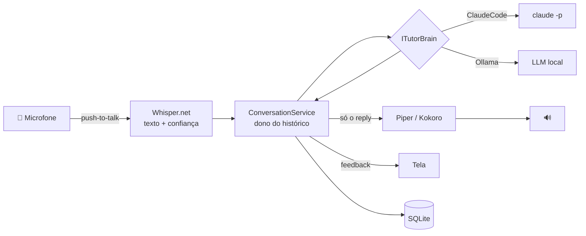
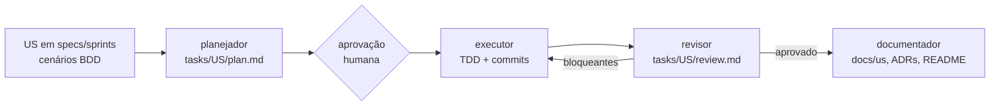

# EnglishTutor 🎙️

Professor de inglês **por voz**, pessoal e local, para treinar fala e escuta: conversação do dia a dia, vocabulário de desenvolvimento de software e simulação de entrevistas técnicas.

O áudio fica na máquina: fala → texto com Whisper, texto → fala com Piper ou Kokoro. O "cérebro" é plugável: **Claude Code headless** (usa a assinatura, sem API key) ou um **modelo local via Ollama** na GPU.

> 🚧 **Status:** Fase 0 concluída (governança e agentes). Sprint 1 em andamento — ver [specs/sprints/SPRINT_1.md](specs/sprints/SPRINT_1.md) e [specs/ROADMAP.md](specs/ROADMAP.md).

## Arquitetura



Detalhes em [ARCHITECTURE.md](ARCHITECTURE.md). Decisões em [docs/adr/](docs/adr/).

## Como o projeto é desenvolvido

Spec-Driven Development com 4 agentes nativos do Claude Code ([ADR-003](docs/adr/ADR-003-fluxo-sdd-com-agentes.md)):



Tudo é conduzido por `/us US-XXX` dentro do Claude Code. Veja [`.claude/`](.claude/) e [CLAUDE.md](CLAUDE.md).

Cinco hábitos de trabalho com IA estão embutidos na estrutura: contexto curto e podado a cada sprint (`/revisar-contexto`), começo devagar com um [diário de aprendizados](docs/aprendizados.md), Definition of Done com comandos verificáveis em cada US, intenção registrada em spec/plano/ADR antes do código, e feedback rápido com hooks que compilam e testam após cada edição.

## Pré-requisitos

| Item | Para quê | Instalação |
|---|---|---|
| .NET 10 SDK | build e execução | `winget install Microsoft.DotNet.SDK.10` |
| Claude Code CLI (autenticado) | provedor `ClaudeCode` | `irm https://claude.ai/install.ps1 \| iex` e depois `claude auth login` |
| Ollama | provedor local | `winget install Ollama.Ollama` |
| GPU NVIDIA + CUDA Toolkit | Whisper na GPU | `winget install Nvidia.CUDA` (Vulkan e CPU como alternativa) |

## Como rodar

> Disponível desde a US-001 (casca de console: cabeçalho, `/help`, `/quit`; ainda sem professor). Logs em `logs/`. Detalhes em [docs/us/US-001.md](docs/us/US-001.md).

```bash
dotnet build
dotnet test --filter "Category!=LiveBrain"
dotnet run --project src/EnglishTutor.Console
```

## Estrutura

```
.claude/        agentes e skills do fluxo SDD
specs/          produto, regras de negócio (RN-*), sprints (US-*), roadmap
tasks/          planos e revisões por US
docs/           ADRs e documentação por US
prompts/        system prompt do professor e instruções de formato
src/ tests/     código (a partir da US-001)
eval/           golden set para comparar cérebros
```

## Licença

A definir.
