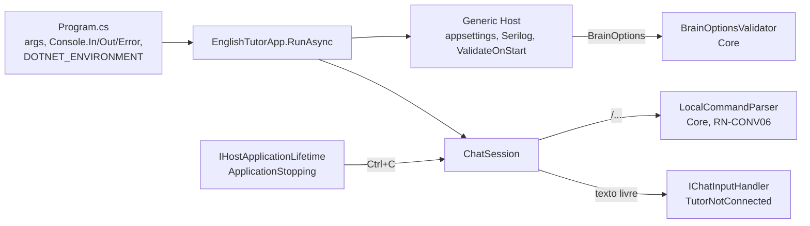

# US-001 — Fundação da solução e configuração

**Sprint:** 1 · **Branch:** feature/US-001_fundacao-solucao · **Status:** Concluída em 2026-10-17 (D13 executado pelo usuário; merge em `develop`)
**Regras:** RN-CONV01, RN-CONV05, RN-CONV06 · **ADRs:** ADR-004 (Aceito), ADR-003

## O que mudou para o usuário

Existe agora uma aplicação de console que ainda não conversa com ninguém, mas já:

- mostra um cabeçalho com o estado: `Brain: ClaudeCode | Mode: free-conversation`, e como pedir ajuda (`/help`) ou sair (`/quit`);
- trata os comandos locais `/help`, `/quit` e comandos desconhecidos (`Unknown command "/xyz".` mais a lista de comandos, e a sessão continua);
- ignora linhas em branco (nada vai ao cérebro, RN-CONV05; o aviso ao aluno é da US-003);
- responde a texto livre com `The tutor is not connected yet.` (provisório, até a US-003/004);
- recusa configuração inválida: com `Brain:Provider` igual a `Inexistente`, escreve `Brain:Provider 'Inexistente' is invalid. Accepted values: ClaudeCode, Ollama.` e sai com código 2;
- encerra com código 0 em `/quit`, fim da entrada e Ctrl+C (o Ctrl+C real foi conferido no D13);
- grava logs estruturados em `logs/englishtutor-AAAAMMDD.log`.

Códigos de saída: `0` sucesso, `1` erro inesperado (inclui falha ao montar o host), `2` configuração inválida.

## Como funciona (resumo técnico)

Solução `EnglishTutor.slnx` com `Core`, `Infrastructure` (vazio nesta US), `Console`, `Core.Tests` e `Console.Tests`. SDK fixado em `global.json`; pacotes em Central Package Management; `TreatWarningsAsErrors` ligado.

Pontos principais:

- **Core** (R1): só referencia `Microsoft.Extensions.Options` e `Microsoft.Extensions.DependencyInjection.Abstractions`. Tem `BrainOptions`, `BrainProviders` (dono único da normalização, `TryGetCanonical`), `BrainOptionsValidator`, `TutorMode` (padrão `free-conversation`), `LocalCommandParser` e `LocalCommands`. Testes de arquitetura garantem a regra por reflexão (shared framework em execução) e pelo `.csproj`.
- **Console**: `EnglishTutorApp` monta o host com `DisableDefaults` (o nome do ambiente vem de `AppRunOptions`, não do processo), liga o token da sessão ao `ApplicationStopping` e traduz exceções em códigos de saída. `ChatSession` lê com `ReadLineAsync(ct).AsTask().WaitAsync(ct)` porque `Console.In` ignora o token, e remove um U+FEFF inicial só da primeira linha (BOM do PowerShell 5.1, decisão P12).
- **Logs**: Serilog só em arquivo, formato CLEF, eventos `[LoggerMessage]`: `ApplicationStarted` 1000, `ApplicationStopped` 1001, `StartupFailed` 1002, `UnexpectedError` 1003, `ApplicationAborted` 1004.
- **CI**: `.github/workflows/ci.yml` (`ubuntu-latest`): build, testes sem `LiveBrain`, cobertura e resumo no step summary.

## Configuração nova

| Chave | Padrão | Observação |
|---|---|---|
| `Brain:Provider` | `ClaudeCode` | `ClaudeCode` ou `Ollama`, sem diferenciar maiúsculas; o cabeçalho mostra o nome canônico. Validada na partida (`ValidateOnStart`). |
| `Serilog:*` | sink `File` em `logs/englishtutor-.log`, rolagem diária, nível `Information` (`Microsoft` em `Warning`) | Lida por `ReadFrom.Configuration`. |
| `DOTNET_ENVIRONMENT` | `Production` | Carrega `appsettings.{Environment}.json` opcional. Lida só em `Program.cs`. |

Também aceita variáveis de ambiente (`Brain__Provider`) e argumentos de linha de comando.

## Testes e evidências

- 36 métodos de teste, 49 casos: Core.Tests 27 (arquitetura/build 4, `BrainProviders` 7 casos, validador, DI, modos, parser) e Console.Tests 22 (`ChatSession` e `EnglishTutorApp`, em processo com leitores e escritores falsos, sem processo externo).
- Cobertura de linhas do `EnglishTutor.Core`: 100% somando os dois projetos (Core.Tests sozinho 89,5%); Console 93,6%.
- Suíte unitária: Core.Tests 72 ms e Console.Tests 327 ms (execução do Executor); o Revisor mediu 67 ms e 356 ms. Sem rede nem GPU.
- `dotnet build` com 0 avisos e `dotnet format --verify-no-changes` sem diferenças (evidências do Executor no `plan.md` §11; D4 e D5 não reproduzidos pelo Revisor).
- Revisão do plano (`plan-review.md`): APROVADO, 14 sugestões incorporadas. Revisão do código (`review.md`): Rodada 1 e Rodada 2 APROVADAS, sem bloqueantes.
- Cenários BDD: 8/8 com verificação; o cenário opcional de CI é conferido por inspeção (D10).

## Decisões e trade-offs

- **ADR-004** (Aceito): Generic Host, validação no Core, logs só em arquivo, testes do console em processo. Nenhum ADR novo foi necessário.
- **Normalização do provedor** em um único método do Core (`TryGetCanonical`), em vez de `IPostConfigureOptions`.
- **P10:** `Microsoft.Extensions.Primitives` aceito no Core só como dependência transitiva do Options.
- **P11:** CI em `ubuntu-latest`; rever quando entrar adaptador só para Windows.
- **P12 (BOM):** tratado na UI (`ChatSession`), não no parser, porque é detalhe da entrada padrão; só a primeira linha perde o BOM.
- **Desvios aceitos pelo usuário** (`plan.md` §12): R1-S2 mensagem `The application could not start: <mensagem>`; R1-S3 teste com `CancellingTextWriter` em vez de token já cancelado (esse cenário nunca chega ao caminho de configuração inválida); R1-S4 evento novo `ApplicationAborted` (1004) em vez de `ApplicationStopped` com código falso.

## Limitações conhecidas / próximos passos

Conferências do usuário:

- **D13** ✅ (2026-10-17): Ctrl+C real no executável encerrou sem stack trace, `$LASTEXITCODE` = 0 e última linha do log `ApplicationStopped` com `ExitCode` 0; D12 repetido sem arquivos gerados no `git status`. Exercitou o caminho `ConsoleLifetime` → `ApplicationStopping`, que o teste automatizado não cobre. Evidência no §11 do `plan.md`.
- **CI** (pendente): a primeira execução no GitHub depende do push feito pelo usuário. Conferir no log o SDK instalado (`dotnet --version`) e se o passo de cobertura publica o resumo.

Pendências aceitas para US futuras (sugestões do Revisor, não bloqueantes, sem implementação nesta US):

- **R1-S5** — `ChatSessionTests.cs`, teste `RunAsync_WhenLaterLineStartsWithByteOrderMark_ForwardsItUnchanged`: fixa que `"\uFEFF/quit"` em linha que não é a primeira vai ao handler. Revisitar quando o handler real entrar (US-003/004), por causa da RN-CONV06.
- **R1-S6** — texto do §3 do `plan.md` sobre `RepositoryRoot.cs`: **já corrigida** (conferido em `plan.md:144`, "Criado (T2, 1ca6aed)").
- **R1-S7** — `NSubstitute` referenciado nos dois projetos de teste sem uso. Se continuar sem uso nas próximas US, remover na poda.
- **R2-S1** — `EnglishTutorApp.cs:42,85-92` e `AppLog.cs:27-30`: o evento `ApplicationAborted` diz que um cancelamento não pedido pela aplicação propagou, mas `exitCode` também fica nulo para qualquer exceção que escape dos `catch` (ex.: `IOException` ao escrever em `Error`). Ajustar o texto para algo neutro ("stopped abnormally; an exception propagated") e o comentário da linha 42, ou registrar o limite.
- **R2-S2** — `plan.md` §2.6/§2.7: a forma escolhida (mensagem da S2, evento 1004) entrou no plano depois do código. Não violou nada, mas gerou o AP-009.
- **R2-S3** — `EnglishTutorApp.cs:126-138`: se `builder.Build()` falhar depois de criar o `serilogLogger`, ele não é descartado. Impacto pequeno (o processo encerra em seguida); descartar na falha ou aceitar formalmente.
- **R2-S4** — o Executor editou o `review.md` do Revisor; vira o AP-011.

Próximo: US-002 (contrato do professor e parser único da resposta). Propostas de melhoria de processo desta US estão em `docs/aprendizados.md` (AP-004 a AP-013), todas aguardando aprovação.
