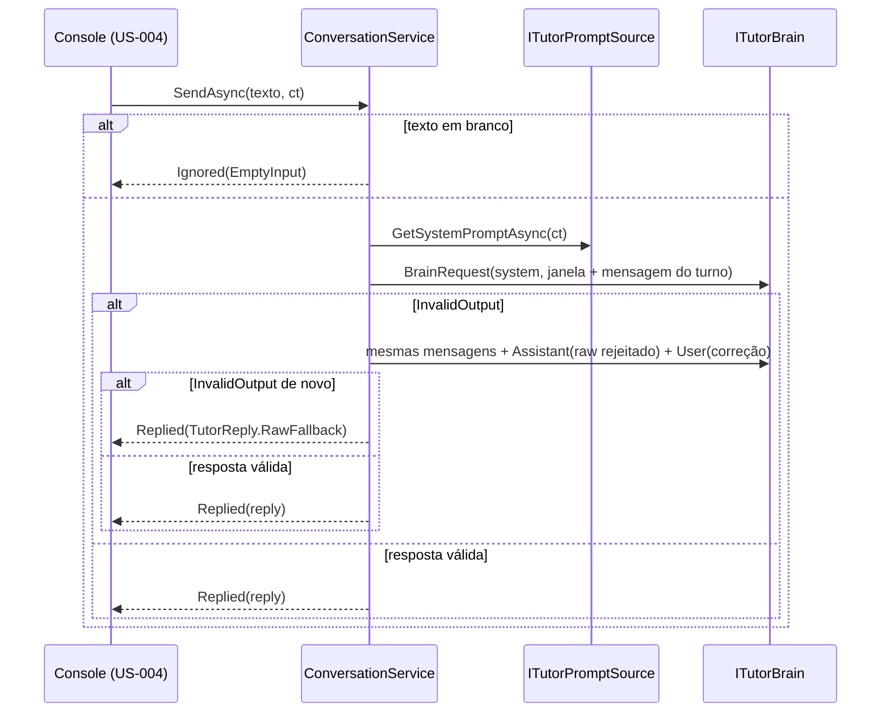

# US-003 — ConversationService dono do histórico

**Sprint:** 1 · **Branch:** feature/US-003_conversation-service · **Status:** Concluída em 2026-10-17 (merge em `develop` pelo orquestrador)
**Regras:** RN-CONV01, RN-CONV02, RN-CONV03, RN-CONV05, RN-CONV06, RN-BRAIN01, RN-BRAIN04 (RN-BRAIN07 só pelo enum `BrainErrorKind`; RN-CONV04 e RN-TTS01 fora de escopo) · **ADRs:** ADR-006 (Aceito, novo), ADR-002, ADR-005

## O que mudou para o usuário

Quase nada que o aluno veja ainda, porque não há cérebro real ligado ao console. O que muda:

- Linha em branco no console mostra o aviso local `Nothing was sent: type a sentence in English and press Enter.` (RN-CONV05) e volta ao prompt, sem enviar nada.
- O Core passa a ter o `ConversationService`, que a US-004 liga ao console: guarda o histórico e o modo ativo, monta a mensagem padrão de cada turno, envia os últimos N turnos ao cérebro e, se a resposta vier fora do formato, tenta de novo uma vez antes de mostrar o texto cru.
- `/mode` já é reconhecido pelo parser de comandos do Core, mas o console ainda responde `Unknown command "/mode".`; a entrega no console está na spec da US-004.

## Como funciona (resumo técnico)

Decisão central no ADR-006: o serviço é dono do histórico e da retentativa de formato. O adaptador do cérebro não guarda estado de conversa e sinaliza formato inválido com `BrainException.InvalidOutput(rejection, rawText)`.

- **Contrato do cérebro** (`Core/Brain/`): `ITutorBrain`, `BrainRequest(SystemPrompt, Messages, SessionHint)`, `BrainMessage`, `BrainRole` (`User`, `Assistant`), `BrainErrorKind` (6 valores da RN-BRAIN07) e `BrainException`. `IsInvalidOutput` é auto-propriedade armazenada com `[MemberNotNullWhen]` (mesma forma da US-002); o construtor público recusa `InvalidOutput` e a fábrica é o único caminho.
- **Conversa** (`Core/Conversation/`): `ConversationService`, `ConversationWindow` (últimos N turnos), `ConversationTurn`, `ConversationTurnResult` (`Replied` ou `Ignored`), `ConversationMessages`, `ITutorPromptSource` (porta do system prompt; arquivo `prompts/tutor.md` na US-004), `TurnMessageBuilder`, `ConversationOptions` e `ConversationOptionsValidator`, `ConversationLog` (EventIds 3000 e 3001, ambos `Warning`).
- **Mensagem do turno (RN-CONV02)**, linhas unidas com `\n`: `Student said (transcribed): "<texto>"`, `Low-confidence words (possible pronunciation issues): []` e `Mode: <modo>`. O texto leva `Trim()`; aspas internas não são escapadas. No modo texto a lista de palavras é sempre vazia.
- **Histórico:** guarda a mensagem formatada do aluno e o `RawText` final do professor. A resposta rejeitada e a instrução de correção não entram. O turno com fallback entra com o texto cru. Falha que não seja de formato, e cancelamento, propagam e o turno não é registrado.
- **`ct` repassado:** o mesmo token vai ao `ITutorPromptSource` e às duas chamadas do cérebro.
- **`TutorReply.RawFallback(rawText)`:** `Reply` com `Trim()`, `RawText` original, sem correções, `IsRawFallback = true`; `FeedbackFormatter` devolve vazio.
- **`/mode`:** `LocalCommandKind.Mode` e `TutorMode.TryParse` (sem diferenciar maiúsculas, com `Trim()`). Fora de `LocalCommands.Available`, para o `/help` só listar o que funciona.
- O serviço é por sessão e não é thread-safe (uma chamada de `SendAsync` por vez).

## Configuração nova

| Chave | Padrão | Observação |
|---|---|---|
| `Conversation:MaxTurnsInWindow` | `10` (RN-CONV03) | Mínimo 1. `ConversationOptionsValidator` registrado em `AddEnglishTutorCore()`. O bind, `ValidateOnStart` e a chave no `appsettings.json` ficam para a US-004 (cenário "janela de turnos configurável" e D8). |

Pacote: `Microsoft.Extensions.Logging.Abstractions` 10.0.13 passa a ser referência direta do Core (permitido por R1) e sua `PackageVersion` foi para o grupo "Core" do `Directory.Packages.props`. `CoreDependencyTests` atualizado. Faixa de EventIds: Conversa 3000–3999.

## Testes e evidências

- 37 métodos / 54 casos novos (após o review). Suíte unitária: **151 casos** (Core.Tests 102, Console.Tests 25, Infrastructure.Tests 24), 0 avisos de build, sem rede nem GPU. Core.Tests em 120 ms (D5); comando inteiro em poucos segundos.
- `ConversationServiceTests`: 18 métodos / 21 casos, cobrindo os 7 cenários da US (mensagem do turno, janela, histórico sem estado do provedor, retentativa, resposta crua, entrada vazia, troca de modo). Mais: `TurnMessageBuilderTests`, `ConversationWindowTests`, `ConversationOptions*Tests`, `BrainExceptionTests`, `TutorReplyTests`, `TutorModeTests`, `LocalCommandParserTests`, `ChatSessionTests` (aviso na linha em branco).
- Cobertura de linhas: `EnglishTutor.Core` **100%**; namespace `Conversation` **100%** (168/168; ramos 85%, 17/20); total da solução 87,8%.
- `dotnet format --verify-no-changes` sem diferenças; D11 (caracteres invisíveis) com contagem 0.
- Valores distintos entre turnos e campos (AP-017): `TutorReplies.Valid(label)` e `raw1` diferente da resposta aceita, para nenhuma asserção de janela passar por coincidência.
- Revisão do plano: 3 rodadas, APROVADO. Revisão do código: Rodada 1 e Rodada 2 APROVADAS, sem bloqueantes. D9 (console no Windows PowerShell 5.1) é evidência do Executor, não reproduzida pelo Revisor (AP-008).

## Decisões e trade-offs

- **ADR-006** (Aceito): retentativa de formato e histórico no `ConversationService`. Descartados: `ITutorBrain` devolvendo `TutorReplyParseResult` (contraria o ADR-005), retentativa no adaptador (viola R4), correção só com `User` sem o `Assistant` rejeitado, system prompt em `ConversationOptions`. Nenhum ADR novo surgiu na implementação.
- **B1 da revisão do plano:** os itens adiados (ligar o serviço ao console, `/mode` no console, bind de `MaxTurnsInWindow`, `SessionHint`) ganharam dono na spec da US-004 (4 cenários e D8 a D10) antes do código, em vez de um terceiro adiamento sem dono.
- `SessionHint` sempre `null` nesta US; a US-004 decide quem guarda a continuidade de sessão (D10).
- Sem `ConversationServiceBuilder` nos testes (um `CreateService(...)` privado basta) e sem `FakeLogger`: copia-se o `RecordingLogger<T>`.
- **Revisão de código:** S2 (campo `_logger` redundante removido; todas as dependências capturadas do construtor primário) e S3 (testes de caracterização das guardas de nulo de `BrainException.InvalidOutput` e `TutorReply.RawFallback`, com Red por mutação). As guardas de `ConversationTurnResult`, `ConversationWindow.Add` e `TurnMessageBuilder` ficaram registradas como defensivas, sem teste; a US que criar um novo chamador acrescenta o teste.
- Escolhas de forma do Executor (`plan.md` §12, E1 a E7), registradas depois dos `feat` na primeira passada (AP-014 recorrente); aceitas pelo usuário.

## Limitações conhecidas / próximos passos

- Sem cérebro nem `ITutorPromptSource` reais: `ConversationService` não está registrado no DI. A US-004 entrega os adaptadores, o registro, o bind da configuração e a ligação ao console.
- O console ainda tem duas checagens de linha em branco (`ChatSession` e `ConversationService`), com o mesmo texto do Core; a US-004 decide se o console delega ao serviço.
- `RawText` vazio gera mensagem `Assistant` vazia na retentativa, e algumas APIs recusam; fica com o adaptador (US-004/US-006), registrado no ADR-006.
- A US-004 atualiza `ChatSessionTests.RunAsync_AfterUnknownCommand_KeepsSessionOpenAndForwardsNothing`, que hoje fixa `Unknown command "/mode".`.
- Fora de escopo: RN-CONV04 (resumo dos erros recorrentes) e persistência, entrada por voz e TTS, mensagens ao aluno por `BrainErrorKind` (US-005), fallback entre provedores (US-007).
- Propostas de melhoria de processo desta US: `docs/aprendizados.md` (AP-022 a AP-031).
