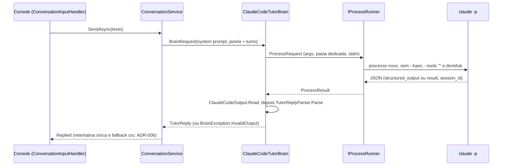

# US-004 — Conversar por texto com o professor via Claude Code

**Sprint:** 1 · **Branch:** feature/US-004_conversa-texto-claude-code · **Status:** Concluída em 2026-10-20 (merge em `develop` pelo orquestrador)
**Regras:** RN-BRAIN01, RN-BRAIN02, RN-BRAIN05, RN-BRAIN06, RN-CONV01, RN-CONV03, RN-CONV05, RN-CONV06, RN-FEED01 (alterada nesta US), RN-FEED02–05 · **ADRs:** ADR-007 (Aceito, novo), ADR-001, ADR-002 (ainda Proposto, com a medição), ADR-004, ADR-005 (revisado), ADR-006

## O que mudou para o usuário

- O console conversa de verdade com o professor. Com `Brain:Provider = ClaudeCode` (padrão), cada frase vira uma chamada ao `claude -p`; o aluno vê `Tutor: <reply>` e, quando há correção, `Feedback:` com linhas `  - original → corrigido (explicação)`.
- `/mode <modo>` troca o modo (`free-conversation`, `job-interview`, `listening-practice`) e confirma com `Mode changed to "<modo>". It applies from your next sentence.`. Modo desconhecido ou ausente mostra os modos disponíveis e não envia nada ao cérebro. O cabeçalho mostra o modo atual; `/help` lista `/mode`.
- Com `Brain:Provider = Ollama` o console continua respondendo `The tutor is not connected yet.` até a US-006.
- Mudança de regra (RN-FEED01): o `reply` deve ter de 1 a 3 frases e **exatamente uma pergunta, em qualquer posição**. Antes, a pergunta tinha de ser a última frase. O modelo costumava fechar com uma frase de incentivo depois da pergunta, o que é pedagogicamente válido. Exemplo aceito: `Was it busy in the morning? Tell me about your commute.`; recusado: `Was it busy? How long was the trip?`.
- A seta `→` do feedback sai legível no console do Windows (saída em UTF-8 sem BOM).
- Falha do cérebro (CLI ausente, sem login, tempo esgotado etc.) ainda encerra o app como erro inesperado (código 1). A mensagem clara e a sessão continuando são da US-005.

## Como funciona (resumo técnico)

Decisão central no ADR-007: um processo `claude -p` isolado por turno, atrás de `IProcessRunner`; o histórico é da aplicação (RN-BRAIN01) e `--resume` é só otimização.

- **Processo por turno** (`Infrastructure/Processes`, `Infrastructure/Brain`): `ProcessRunner` é o único lugar com `System.Diagnostics.Process` (`ArgumentList`, stdin/stdout/stderr em UTF-8 sem BOM, leituras iniciadas antes da escrita do stdin, `Kill(entireProcessTree: true)` no cancelamento). Sem teste unitário, por lançar processo real; é exercitado pelos testes `LiveBrain`.
- **System prompt** em arquivo temporário fora da pasta de trabalho (`--system-prompt-file`), apagado num `finally`; a instrução de formato vai em `--append-system-prompt-file` (`format.json.md` ou `format.tags.md`). Pasta de trabalho dedicada, criada se faltar (RN-BRAIN06).
- **Histórico e `--resume`:** o histórico é renderizado num texto único no stdin. O `session_id` fica no adaptador e só é reaproveitado quando o request estende exatamente a sessão conhecida (mesmo system prompt, mesmas mensagens, mais uma mensagem do aluno). Depois de uma retentativa de formato, ou quando a janela desliza (a partir do turno `MaxTurnsInWindow + 2`, padrão 12), o turno abre sessão nova.
- **Leitura da saída** (`ClaudeCodeOutput.Read`, tabela do plano §2.5): código de saída diferente de 0, stdout que não é o JSON `type: result` e `is_error: true` viram `BrainException(Unknown)` sem passar pelo parser; `structured_output` objeto tem prioridade sobre `result`. A classificação por `BrainErrorKind` é da US-005.
- **Contrato de conteúdo no Core** (R4): `TutorReplyValidator` conta perguntas com o separador de frases `ReplySentences` (só BCL; sem `EndsWith('?')`) e recusa com `reply must ask the student exactly one question` (diz quantas encontrou). Limites aceitos do separador: abreviação como `Mr.` seguida de maiúscula conta como fim de frase; frase nova em minúscula depois de `?` não é separada.
- **Console:** `IChatInputHandler` ganhou `Mode`/`ChangeMode`; `ConversationInputHandler` (novo) mostra reply e feedback; `ChatSession` trata `/mode` sem enviar nada ao handler (RN-CONV06). `EnglishTutorApp` reconhece várias Options inválidas de uma vez (`AggregateException` só com `OptionsValidationException`) e mantém `Invalid configuration:` com código 2. `AppRunOptions.ConfigureServices` permite aos testes trocar o cérebro sem processo real.
- **DI:** `AddEnglishTutorInfrastructure(promptsDirectory)` registra runner, parser, `PromptFiles`, `FileTutorPromptSource`, `ClaudeCodeTutorBrain` (fixo em ClaudeCode até a `BrainFactory` da US-007) e o validador de `ClaudeCodeOptions`; `AddEnglishTutorCore()` registra `ConversationService`. `prompts/**` é copiado para a saída do Console e dos testes.

## Configuração nova (chaves do appsettings, valores padrão)

| Chave | Padrão | Observação |
|---|---|---|
| `Brain:Provider` | `ClaudeCode` | já existia; agora é o padrão no `appsettings.json` |
| `Brain:ClaudeCode:ExecutablePath` | `claude` | nome ou caminho; use o instalador nativo (`claude.exe`), o shim `.cmd` do npm reinterpreta as aspas do schema (ADR-007) |
| `Brain:ClaudeCode:Model` | `haiku` | nome ou alias do modelo |
| `Brain:ClaudeCode:WorkingDirectory` | `%LOCALAPPDATA%/EnglishTutor/brain` | pasta vazia e dedicada (RN-BRAIN06) |
| `Brain:ClaudeCode:UseResume` | `true` | `--resume` como otimização |
| `Brain:ClaudeCode:OutputMode` | `JsonSchema` | `JsonSchema` ou `Tags`; aceita outra caixa, o adaptador usa o valor canônico |
| `Conversation:MaxTurnsInWindow` | `10` | agora com bind e `ValidateOnStart` (RN-CONV03); valor inválido encerra com código 2 |

`TimeoutSeconds` não entrou: é da US-005.

## Testes e evidências

- Suíte unitária (`Category!=LiveBrain`): **249 testes** (Core 134, Console 41, Infrastructure 74), 0 falhas, 0 avisos de build, sem rede nem processo real. Na revisão, cada projeto levou menos de 0,5 s; o comando inteiro, incluindo build, ficou em 5 a 7 s (evidência do Executor). Na rodada 1 da revisão eram 216 testes; a mudança da RN-FEED01 acrescentou 33.
- Testes `LiveBrain` (exigem CLI autenticada): `ClaudeCodeTutorBrainLiveTests` (3, o D5), `FixtureRecorderLiveTests` (grava as fixtures `claude-json-*.json`) e `LatencyMeasurementLiveTests` (D7).
- Cobertura de linhas: `EnglishTutor.Core` **100%**; Infrastructure 83,5%; Console 93,4%; total 88,7%.
- Cenários BDD: 11/11 com teste, escritos antes do código (ordem de commits conferida na revisão). Os casos de falha da leitura da saída usam um `structured_output` válido, de modo que só passam se a regra certa for aplicada.
- **Latência (D7, dados no ADR-002):** `haiku`, 5 frases por modo, processo novo por chamada, sem `--resume`. JsonSchema: média 4982 ms, p95 5554 ms, 0 fora do formato. Tags: média 3642 ms, p95 4183 ms, 1 fora do formato. O `--json-schema` custou cerca de 1,3 s a mais por turno, com 5/5 no formato contra 4/5. Amostra pequena; a US-009 repete com o golden set.
- **D5 (ao vivo):** depois da mudança da RN-FEED01 e do reforço de prompt (`f237c82`), 5 rodadas seguidas verdes (3 testes cada, 8 chamadas por rodada, 40 respostas), no ambiente limpo definido na DoD (sem `CLAUDECODE`, `CLAUDE_CODE_*`, `ANTHROPIC_BASE_URL`). Esta evidência é do Executor; o Revisor não a reproduziu (custa assinatura, AP-008). D6 e D9 (Windows PowerShell 5.1) também são do Executor.
- Revisão do plano: 5 rodadas, APROVADO. Revisão do código: Rodada 1 REPROVADA (B1, D5 intermitente); Rodada 2 APROVADA, 0 bloqueantes.

## Decisões e trade-offs

- **ADR-007 (Aceito):** processo por turno, histórico renderizado no stdin, `session_id` no adaptador e `--resume` só quando o request estende exatamente a sessão. `BrainRequest.SessionHint` fica reservado (sempre `null`). Nenhum ADR novo surgiu na implementação.
- **RN-FEED01 mudou para "exatamente uma pergunta"** durante esta US (`BUSINESS_RULES.md`, histórico de 2026-10-19; plano §2.10 e §12). O D5 ficou intermitente porque o modelo fechava o `reply` com incentivo depois da pergunta e o validador recusava `reply must end with a question`. A decisão foi do usuário: mudar a regra em vez de enfraquecer o critério do D5. ADR-002 e ADR-005 foram atualizados (ADR-005 com "Revisado"), junto com ARCHITECTURE, PRODUCT, US-002 e a skill `tdd-dotnet`.
- **Privacidade do ambiente herdado (aceita de forma explícita pelo usuário).** O processo `claude` herda o ambiente de quem abre o console e a configuração de usuário da CLI (`~/.claude`). Numa gravação feita pelo app desktop, o nome do titular da conta chegou ao contexto do professor. Motivo da aceitação: o app é local, usado por uma pessoa na própria máquina, e o dado só vai a quem já é titular da conta. Mitigações em vigor: fixtures gravadas sem as variáveis herdadas (D13) e comando do D5/D6/D7 que limpa as variáveis. Condição para revisitar: distribuir o app a outras pessoas ou abri-lo em ambiente com variáveis de conta de terceiros; aí o usuário decide, com ADR, a limpeza do ambiente (por exemplo no `ProcessRunner`) ou o uso de `--setting-sources`. Sem US de destino e sem ADR agora (plano §7 e §8).
- **Medição ao vivo com tolerância zero:** o D5 mede o adaptador, sem a retentativa do ADR-006 que o produto tem. Foi mantido assim, sem enfraquecer o critério.
- `Brain:ClaudeCode` inválido impede a partida mesmo com `Brain:Provider = Ollama` (o bind vale para qualquer provedor, coerente com o registro fixo e com a US-007, em que ClaudeCode pode ser fallback). A saída é a de configuração inválida, com a chave e os valores aceitos.

## Limitações conhecidas / próximos passos

- **Risco residual do D5 (S5 da Rodada 2).** O D5 verde se apoia em 5 rodadas de 8 chamadas (40 respostas), contra uma falha anterior de 5 a 10% por chamada; é compatível com uma taxa baixa, mas não a prova. O critério é "5/5 no formato" no adaptador, sem retentativa, e pode oscilar de novo (por exemplo nas US-005 ou US-006). Se voltar a ficar vermelho, o usuário decide a camada de medição (serviço com retentativa) ou a tolerância, **com registro prévio na spec** (DoD da US). O `because` do teste mostra a frase, a resposta recusada e o motivo, o que facilita classificar. Abreviações (`Mr.`, `Dr.`) que façam o teste do cenário 1 contar mais de 3 frases são limite do separador (S7), não falha do modelo.
- **Pendência por decisão do usuário (S4 da revisão):** o teste de `ChangeMode` do `TutorNotConnectedInputHandler` (42,8% de cobertura de linhas nesse handler) continua pendente. O handler é provisório até a US-006.
- Falhas do cérebro (CLI não encontrada, não autenticado, limite de uso, tempo esgotado, falha genérica) e a sessão continuar depois delas: **US-005**, cuja spec ganhou o cenário "falha do cérebro no console não encerra a sessão". `Win32Exception` por executável inexistente propaga até lá.
- Ollama no console e `BrainFactory`/fallback: US-006 e US-007. `FakeProcessRunner` e as fixtures desta US serão consumidos pela suíte de contrato da US-008; a US-009 mede a taxa de sessões novas por `--resume` e repete a latência (ADR-002 segue Proposto até lá).
- S6 da Rodada 2 (rótulo de cenário em `TutorReplyValidatorTests`) foi corrigido em `e220427`.
- Propostas de melhoria de processo desta US: `docs/aprendizados.md` (AP-032 a AP-042).
