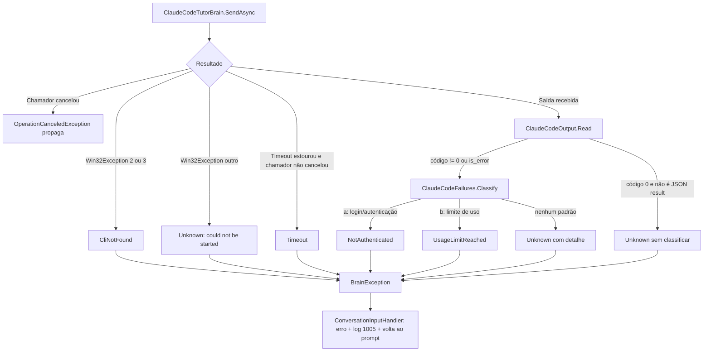

# US-005 — Erros do Claude Code com mensagens claras

**Sprint:** 1 · **Branch:** feature/US-005_erros-claude-code · **Status:** Concluída em 2026-10-21 (merge em `develop` pelo orquestrador)
**Regras:** RN-BRAIN07, RN-BRAIN09 (e, sem mudança, RN-BRAIN01, RN-BRAIN04, RN-BRAIN06, RN-BRAIN08, RN-CONV05) · **ADRs:** ADR-008 (Aceito, novo), ADR-007 (item 5 complementado)

## O que mudou para o usuário

- Quando o professor não responde, o console escreve na **saída de erro** duas linhas e volta ao prompt, sem encerrar a sessão:
  - `The tutor could not answer: <o que houve e o que fazer>`
  - `You can send a sentence again or type /quit to exit.`
- Mensagens por tipo de falha (em inglês, o aluno está praticando):
  - **CLI não encontrada** (`CliNotFound`): `Claude Code CLI not found ("<ExecutablePath>")`, com o instalador nativo (`irm https://claude.ai/install.ps1 | iex`) e a chave `Brain:ClaudeCode:ExecutablePath`.
  - **Não autenticado** (`NotAuthenticated`): pede `claude auth login` e lembra de conferir ou remover `ANTHROPIC_API_KEY` se ela estiver definida (frase fixa, o app não lê o ambiente).
  - **Limite de uso** (`UsageLimitReached`): manda esperar o plano reiniciar e enviar a frase de novo.
  - **Tempo esgotado** (`Timeout`): `Claude Code did not answer in time (limit: <n> s) and was stopped`, com a chave `Brain:ClaudeCode:TimeoutSeconds`. O processo e seus filhos são encerrados.
  - **Executável existe mas não inicia** (código do sistema diferente de 2 e 3, ex.: acesso negado): `Unknown` com `could not be started (..., error <código>)` e a chave `ExecutablePath`.
  - **Demais falhas** (`Unknown`): mantêm o texto da US-004 com o detalhe (`Claude Code failed (exit code <n>): ...`).
- `Brain:ClaudeCode:TimeoutSeconds` (padrão 60, faixa 1 a 3600) limita cada chamada ao processo. Valor fora da faixa encerra o app antes do prompt, com código 2 e mensagem que diz o valor encontrado e o esperado.
- O turno que falhou não entra no histórico; a frase seguinte é enviada normalmente e, após `Timeout`, o adaptador abre sessão nova (sem `--resume`).

## Como funciona (resumo técnico)

Decisão central no ADR-008: a classificação é do adaptador; a `BrainException.Message` é o texto para o aluno; o console só captura `BrainException`.

- **Tempo máximo (RN-BRAIN09):** `CancellationTokenSource(TimeSpan, TimeProvider)` ligado ao token do chamador, criado por chamada ao processo (inclui a escrita do arquivo temporário do system prompt). O `ProcessRunner` já encerra a árvore (`Kill(entireProcessTree: true)`) ao cancelar. O filtro `when (timeout.IsCancellationRequested && !ct.IsCancellationRequested)` garante que Ctrl+C nunca vira `Timeout`, nem quando o tempo também estourou.
- **Classificação por texto:** `ClaudeCodeFailures.Classify(errorResult, stderr)` examina sempre as duas fontes (o `result` de erro do JSON e o stderr inteiro), sem diferenciar maiúsculas, nesta ordem: (a) `not logged in`, `/login`, `invalid api key`, `authentication_error`, `oauth token` → `NotAuthenticated`; (b) `usage limit`, `hit your limit` → `UsageLimitReached`; senão `Unknown`. Saída com código 0 que não é o JSON `type: result` não é classificada. `rate_limit` (limite momentâneo da API) fica `Unknown`.
- **Executável inexistente:** o `IProcessRunner` documenta que lança `Win32Exception` quando não consegue iniciar; o adaptador traduz (`NativeErrorCode` 2 ou 3 → `CliNotFound`; outros → `Unknown`). O Core não muda (R1, R4).
- **Console:** `ConversationInputHandler` captura só `BrainException`, escreve em `Error` via `ConsoleText.BrainFailed`, registra `AppLog.BrainFailed` (EventId 1005, `Warning`, sem texto do aluno) e retorna. Qualquer outra exceção, inclusive `OperationCanceledException`, propaga.
- **Fixtures de erro** (`tests/EnglishTutor.Infrastructure.Tests/Fixtures/ClaudeCode/errors/`): `not-authenticated` e `unknown-model` foram **gravadas** com a CLI 2.1.304 e os mesmos argumentos de isolamento do adaptador; `usage-limit-synthetic-1` e `-2` são **sintéticas**, porque o limite de uso não é reproduzível sob demanda. O `README.md` da pasta registra as diferenças em relação à chamada do adaptador e manda trocar o sintético na primeira ocorrência real.

## Configuração nova (chaves do appsettings, valores padrão)

| Chave | Padrão | Validação |
|---|---|---|
| `Brain:ClaudeCode:TimeoutSeconds` | `60` | 1 a 3600; fora da faixa: `Brain:ClaudeCode:TimeoutSeconds must be between 1 and 3600 (found <valor>). Expected the maximum number of seconds to wait for each Claude Code call (default: 60).` |

## Testes e evidências (2026-10-21, código em `66e37c6`; `581ed2c` só reordena membros de `ClaudeCodeFailures`)

- Suíte sem `LiveBrain`: **286 testes** verdes (Core 134, Infrastructure 101, Console 51; eram 249 na US-004), 4,6 s no total, incluindo build.
- Por tipo: 69 testes casam com `ClaudeCode` (D5), incluindo um por `BrainErrorKind` produzido pelo adaptador; `ClaudeCodeTutorBrainTests` tem 53 casos em 29 métodos; `EnglishTutorAppTests` 25 casos (5 do cenário "falha do cérebro no console não encerra a sessão").
- `LiveBrain`: +2 (`ProcessRunnerLiveTests`: executável ausente e encerramento da árvore de processos, sem usar a CLI). D10: 3 rodadas verdes. D13: 3 rodadas de `ClaudeCodeTutorBrainLiveTests` verdes (41 a 43 s cada).
- Cobertura de linhas do `EnglishTutor.Core`: **100%** (meta 80%); solução: 89,2%.
- `dotnet build` 0 avisos; `dotnet format --verify-no-changes` limpo; caracteres invisíveis no diff: 0.
- Execuções reais no Windows PowerShell 5.1 com pipe (D6, D11, D12): CLI ausente, `TimeoutSeconds=1` e `CLAUDE_CONFIG_DIR` vazio mostraram as mensagens esperadas e terminaram com `exit=0`.
- Red por mutação nas tarefas T1, T2, T4b, T5 e T6, desfeitas pela edição inversa (detalhes em `tasks/US-005/plan.md`, seção 11).
- Revisão (`tasks/US-005/review.md`): APROVADO, 0 bloqueantes. A S2 (ordem dos membros de `ClaudeCodeFailures`) foi aplicada em `581ed2c`; a S1 virou aprendizado (AP-043) e a S3 não exige ação.

## Decisões e trade-offs

- **ADR-008 (Aceito):** classificação no adaptador, texto ao aluno na exceção, tempo máximo por chamada ao processo. Alternativas descartadas: textos por `BrainErrorKind` no console; classificar por código de saída ou `subtype`; tipo `ProcessStartException` no runner; tempo no `ProcessRunner` ou por turno.
- **Tempo por chamada, não por turno:** um turno com retentativa de formato (ADR-006) pode levar até 2 x `TimeoutSeconds`.
- **Texto da CLI como contrato frágil:** se a CLI mudar as mensagens, a falha cai em `Unknown` com o detalhe e a sessão continua. As fixtures gravadas registram a versão da CLI para regravar quando ela atualizar.
- **Mensagem de `NotAuthenticated` sempre cita `ANTHROPIC_API_KEY`:** custa uma frase ao aluno sem a variável e evita deixar preso quem a tem inválida.
- **Log no console, não no adaptador:** o console é quem encerra o tratamento (EventId 1005).
- **`FakeTimeProvider`** (pacote `Microsoft.Extensions.TimeProvider.Testing` 10.11.0, só em testes) substituiu o `ManualTimeProvider`, que foi apagado.

## Limitações conhecidas / próximos passos

- **US-007 (fallback):** a RN-BRAIN08 aciona o fallback para `UsageLimitReached`, `Timeout`, `CliNotFound` e `NotAuthenticated`, não para `Unknown`. Um `ExecutablePath` que existe mas não pode ser executado (códigos 5 e 193) vira `Unknown` e **não aciona o fallback**. Um limite de uso com texto novo da CLI também cai em `Unknown`.
- A fixture de limite de uso é sintética; trocar pela gravada na primeira ocorrência real (sem US de destino).
- O detalhe mostrado na mensagem pode ser uma linha sem relação direta com o padrão que casou (regra de detalhe da US-004 mantida); o tipo e a ação continuam corretos.
- O `IProcessRunner` não define variáveis de ambiente por chamada; o ambiente herdado segue como risco aceito (AP-034, US-004).
- A US-006 deve seguir o mesmo padrão: `BrainException.Message` com o que houve e o que fazer; o console já mostra qualquer `BrainException`.
