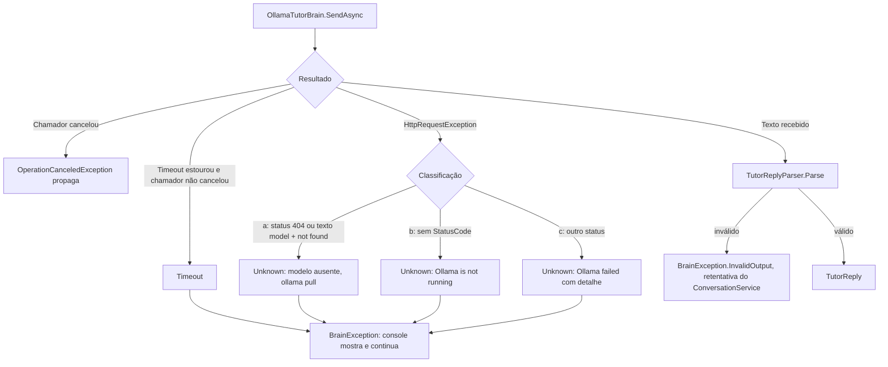

# US-006 — Professor local via Ollama

**Sprint:** 1 · **Branch:** feature/US-006_ollama-brain · **Status:** Concluída em 2026-10-22 (merge em `develop` pelo orquestrador)
**Regras:** RN-BRAIN01–05, RN-BRAIN07, RN-BRAIN09 (e, sem mudança, RN-BRAIN04, RN-BRAIN08, RN-CONV03), RN-FEED01 (alterada em 2026-10-22: tolerância de 1 ou 2 perguntas) · **ADRs:** ADR-009 (Aceito, novo); ADR-005 e ADR-002 revisados (tolerância); ADR-006 (retentativa, agora contada no D5)

## O que mudou para o usuário

- Com `Brain:Provider = Ollama`, o console conversa com um modelo local (padrão `qwen2.5:14b-instruct-q4_K_M`) pelo mesmo `ConversationService`, com a mesma tela do Claude Code: linha `Tutor: <reply>` e o feedback do turno. O texto "The tutor is not connected yet." deixou de existir.
- Falhas do Ollama aparecem na saída de erro, em inglês, e a sessão continua (mesmas duas linhas da US-005):
  - **Fora do ar:** `Ollama is not running at "<Endpoint>". Start it (open the Ollama app, or run "ollama serve" ...)`, com a chave `Brain:Ollama:Endpoint`.
  - **Modelo não baixado:** `Ollama model "<Model>" is not downloaded. Run "ollama pull <Model>" ...`, com a chave `Brain:Ollama:Model`.
  - **Tempo esgotado:** `Ollama did not answer in time (limit: <n> s) and the request was cancelled ...`, com a chave `Brain:Ollama:TimeoutSeconds`.
  - **Demais falhas:** `Ollama failed (<primeira linha do detalhe>). Check that the Ollama server is healthy ...`.
- Tolerância de verificação (RN-FEED01, 2026-10-22): o `reply` com **1 ou 2 perguntas** é aceito para qualquer provedor; 0 e 3 ou mais continuam recusados. O prompt continua pedindo exatamente uma. Os prompts `format.json.md` e `format.tags.md` foram reforçados (contagem de `?` e exemplo proibido) para o modelo de 14B.
- Uma seção `Brain:Ollama` inválida encerra o app na partida (código 2), mesmo com `Brain:Provider = ClaudeCode` (limite aceito, P12).

## Como funciona (resumo técnico)

Decisão central no ADR-009: `OllamaTutorBrain` (Infrastructure) implementa `ITutorBrain` sobre `IChatClient` (`Microsoft.Extensions.AI`), com o `OllamaApiClient` do pacote `OllamaSharp` 5.5.0, criado por `OllamaChatClients.Create(OllamaOptions, HttpMessageHandler?)`. Os testes trocam só o `HttpMessageHandler`, então conferem o fio real (`/api/chat`, `messages`, `format`). O adaptador não guarda estado (RN-BRAIN01): monta a mensagem `system` (system prompt + arquivo de formato do modo), repassa a janela completa sem filtrar nada e usa `format` com o JSON Schema do `TutorReply` no modo `JsonSchema`. O Core não mudou, exceto o `TutorReplyValidator` e o catálogo de rejeições (tolerância).

- **Tempo máximo (RN-BRAIN09):** `CancellationTokenSource(TimeSpan, TimeProvider)` ligado ao token do chamador, um por chamada, com o filtro `timeout.IsCancellationRequested && !ct.IsCancellationRequested` (Ctrl+C nunca vira `Timeout`). O `HttpClient.Timeout` fica infinito; o limite é o do adaptador. Um turno com retentativa pode levar até 2 x `TimeoutSeconds`.
- **Falhas:** o adaptador captura só `HttpRequestException`. Observado com a biblioteca real: modelo ausente = `HttpRequestException` com `StatusCode` 404 (o texto `model not found` está só no corpo, por isso a linha a casa pelo status); conexão recusada = `HttpRequestException` sem status, com `SocketException` interna. Todas as falhas do servidor são `BrainErrorKind.Unknown` (nenhum valor novo no enum, P2); `Timeout` é o único com tipo próprio.
- **Console:** o `ConversationInputHandler` passou a servir qualquer provedor; `TutorNotConnectedInputHandler` e `ConsoleText.TutorNotConnected` saíram.
- **DI:** registro de `OllamaTutorBrain`, do `IChatClient` com chave `"Ollama"` e do `OllamaOptionsValidator`, mais um **seletor provisório** de `ITutorBrain` por `Brain:Provider` (comentário `Provisional selector until the BrainFactory (US-007)`), que a US-007 remove (D7 da US-007 confere por `git grep`).
- **Fixtures** (`tests/EnglishTutor.Infrastructure.Tests/Fixtures/Ollama/`): `chat-structured.json`, `chat-request.json`, `model-not-found.*`, gravadas pelo próprio adaptador (`OllamaFixtureRecorderLiveTests`, Ollama 0.40.7). O `chat-request.json` foi gravado antes do reforço dos prompts e o `README.md` da pasta diz isso.

## Configuração nova (chaves do appsettings, valores padrão)

| Chave | Padrão | Validação |
|---|---|---|
| `Brain:Ollama:Endpoint` | `http://localhost:11434` | URL absoluta `http` ou `https` |
| `Brain:Ollama:Model` | `qwen2.5:14b-instruct-q4_K_M` | não vazio |
| `Brain:Ollama:Temperature` | `0.6` | 0 a 2 |
| `Brain:Ollama:TimeoutSeconds` | `60` | 1 a 3600 |
| `Brain:Ollama:OutputMode` | `JsonSchema` | `JsonSchema` ou `Tags` (sem diferenciar maiúsculas) |

Cada chave inválida gera uma falha própria do `OllamaOptionsValidator`, com o valor encontrado e o esperado.

## Testes e evidências (2026-10-22, código em `8592c0c`; `d614a4e` só remove uma asserção de um teste `LiveBrain`)

- Suíte sem `LiveBrain`: **366 testes** verdes (Core 138, Infrastructure 173, Console 55; eram 286 na US-005), menos de 1 s por projeto.
- Por tipo: 69 casos casam com `Ollama` fora do `LiveBrain` (Infrastructure 65, Console 4); testes de fio com o `OllamaApiClient` real e `HttpMessageHandler` falso; testes de tolerância nos dois lados de cada limite (0, 1, 2, 3 e 4 perguntas); guarda de conteúdo dos prompts (`PromptFilesContentTests`).
- `LiveBrain` (Ollama): 5 testes por rodada, incluindo `OllamaConversationLiveTests.SendAsync_WithFiveKnownErrors_AllInFormatCountingTheSingleRetry`, que monta o `ConversationService` real sobre o `OllamaTutorBrain` real. D5: 3 rodadas seguidas com `exit=0` (14 a 15 s cada); e uma rodada extra verde depois de `d614a4e`. D19 (Claude Code, `LiveBrain`): 3 testes verdes depois do reforço dos prompts.
- Cobertura de linhas do `EnglishTutor.Core`: **100%** (meta 80%); solução: 90,1%.
- `dotnet build` 0 avisos; `dotnet format --verify-no-changes` limpo; caracteres invisíveis no diff: 0; `dotnet list package --vulnerable`: nenhum.
- D6 (VRAM, registrada em ARCHITECTURE §7): linha de base 1568 MiB, pico 10828 MiB; `ollama ps` 9,5 GB, 100% GPU, contexto 4096.
- D7 a D10 no Windows PowerShell 5.1: resposta normal com feedback (`since five years → for five years`), Ollama fora do ar, modelo ausente e `TimeoutSeconds=1` mostraram as mensagens esperadas e terminaram com `exit=0`.
- Revisão (`tasks/US-006/review.md`): APROVADO, 0 bloqueantes, 49 commits revisados. S1 aplicada em `d614a4e`; S2 e S3 viram limites abaixo.

## Decisões e trade-offs

- **ADR-009 (Aceito):** `IChatClient` sobre `OllamaSharp`; `Unknown` para "fora do ar" e "modelo ausente"; tempo por chamada igual ao do Claude Code. Alternativas descartadas: `HttpClient` direto, valores novos em `BrainErrorKind`, `BrainFactory` nesta US, sem tempo máximo.
- **Falhas `Unknown` não acionam o fallback da US-007** (RN-BRAIN08 só aciona para `UsageLimitReached` e `Timeout`): com o Ollama como `Provider`, "fora do ar" e "modelo ausente" não chamam o reserva. Nenhum cenário atual depende disso (Claude Code é o primário no cenário de fallback).
- **D5 vermelho e a decisão do usuário (2026-10-22):** com a regra "exatamente 1" e sem retentativa, 0 a 2 frases de 5 saíam do formato, todas por contagem de perguntas (o `format` garante o JSON, não a regra de conteúdo). Foram escolhidas três camadas: tolerância de 1 ou 2 no validador do Core (convenção "Tolerância de verificação"), prompts reforçados (a regra de uma pergunta fica no texto) e D5 medido com a retentativa única do ADR-006. Descartadas: tolerância de 4/5 no D5 e trocar de modelo. Nenhum ADR novo: é revisão do ADR-005.
- **A frase da tolerância chega ao modelo só pela mensagem de correção da retentativa** (`Replies with 1 or 2 questions are accepted.`), não pelos arquivos de prompt. Se o D5 oscilar, ela é a primeira candidata a sair.
- **S1 da revisão (gravador fora do D5), substitui a P17 para este gravador:** o plano (§2.12, linha do gravador "sem mudança"; §7, "gravadores continuam exigindo 1 pergunta"; P17) mantinha `Be(1)` no `OllamaFixtureRecorderLiveTests`. Como esse teste roda no filtro do D5 e chama o adaptador sem a retentativa, uma resposta tolerada de 2 perguntas deixaria o D5 vermelho sem regressão. Por decisão do usuário (§12 do plano, `d614a4e`), o gravador só grava e confere o 404 do modelo ausente. A conferência de "1 pergunta" (regra pedida) fica na fixture gravada, de forma determinística: `OllamaTutorBrainHttpTests.SendAsync_WithRecordedStructuredResponse_ReturnsReplyAndCorrections`. A P17 continua valendo para o `FixtureRecorderLiveTests` do Claude Code (fora do filtro do D5) e para os testes de fixture gravada. O plano não foi reescrito.
- **JSON em cerca markdown continua rejeitado (P6):** a resposta real gravada com `format` veio como JSON puro.
- **Primeira chamada do modelo é lenta:** `total_duration` de cerca de 54,7 s na gravação (carga na VRAM), perto do padrão de 60 s; a mensagem de `Timeout` aponta para `Brain:Ollama:TimeoutSeconds`.

## Limitações conhecidas / próximos passos

- **Risco S2 (retentativa não medida ao vivo):** o D5 verde **não exercitou a retentativa**: nas 3 rodadas `ollama-smoke.txt` registrou `first attempt invalid: 0/5; retries used: 0`. O D5 mede o adaptador com os prompts reforçados dentro do `ConversationService`, não a retentativa. Ela está provada só por testes unitários (US-003) e pela mutação da T13 (decorator que rejeita tudo derruba o teste). A US-007 e a US-009 **não devem herdar uma garantia medida** de recuperação por retentativa com o modelo real.
- **Risco S3 (margem nula nas correções esperadas):** a fumaça achou **4/5 correções esperadas nas 3 rodadas**, e o critério só exige o formato. Está de acordo com a tolerância da US (e com o 4/5 do Claude Code), mas sem margem: é risco para o `eval` da US-009 (D6: correções encontradas ≥ 80%, que 4/5 = 80% só atinge no limite, e o golden set terá cerca de 30 frases).
- **Oscilação residual do formato:** o 14B ainda pode errar a contagem de perguntas (ou passar de 3 frases, que ninguém valida) nas duas tentativas; o D5 vermelho é decisão do usuário, com registro prévio na spec.
- **Seletor provisório de `ITutorBrain`** em `InfrastructureServiceCollectionExtensions` (uma linha em `git grep -F "Provisional selector"`): removido pela `BrainFactory` na US-007.
- Falhas do Ollama como `Unknown` não acionam fallback (ver decisões). Mudar isso exige valores novos em `BrainErrorKind`, spec antes do código.
- `chat-request.json` gravado antes do reforço dos prompts; não é lido por teste.
- Fora de escopo, sem US de destino: streaming, `keep_alive`, `num_ctx`; validação de quantidade de frases no Core.
