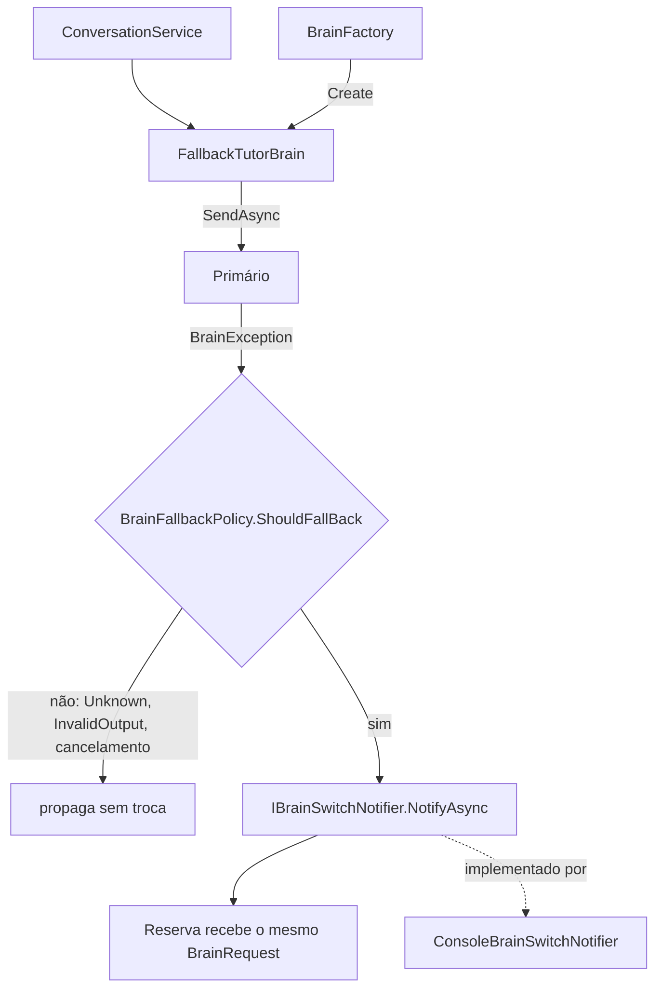

# US-007 — Troca de cérebro por configuração e fallback

**Sprint:** 1 · **Branch:** feature/US-007_troca-cerebro-fallback · **Status:** Concluída em 2026-10-22 (merge em `develop` pelo orquestrador)
**Regras:** RN-BRAIN08 (e, sem mudança, RN-BRAIN07, RN-BRAIN04, RN-BRAIN01); ARCHITECTURE §6.1, §6.3, §6.5 · **ADRs:** ADR-010 (Aceito, novo); ADR-009 (item "seletor provisório" fechado)

## O que mudou para o usuário

- `Brain:Provider` escolhe o cérebro (`ClaudeCode` ou `Ollama`, sem diferenciar maiúsculas) e o cabeçalho mostra o provedor.
- Nova chave `Brain:FallbackProvider`. Com ela preenchida, se o cérebro principal falhar com limite de uso, tempo esgotado, CLI não encontrada ou não autenticado, o turno vai para o reserva e a tela mostra `Switched to <reserva> (<motivo>)` antes de `Tutor: <reply>`. Motivos: `usage limit reached`, `timed out`, `CLI not found`, `not authenticated`.
- Cada turno tenta o principal primeiro; a troca vale só para aquele turno.
- Falha desconhecida (`Unknown`) ou de formato (`InvalidOutput`) não aciona o reserva: a mensagem aparece na saída de erro e a sessão continua. Sem reserva, tudo se comporta como antes (limite de uso aparece como mensagem e a sessão segue).
- Reserva igual ao principal (ex.: `ClaudeCode` e `claudecode`) ou desconhecido encerra o app na partida com código 2 e mensagem que diz o esperado.
- Na tela, o aviso aparece com o prefixo do prompt (`> Switched to ...`), porque o prompt `> ` não quebra linha.

## Como funciona (resumo técnico)

Decisão central no ADR-010: a política mora no Core, o decorator na Infrastructure e o aviso passa por uma porta implementada no console.

- **Core:** `BrainFallbackPolicy` (4 tipos trocam), `BrainSwitchNotice(FromProvider, ToProvider, Reason)`, `IBrainSwitchNotifier`; `BrainOptionsValidator` agora coleta uma falha por chave inválida (inclui `FallbackProvider`).
- **Infrastructure:** `FallbackTutorBrain` (sem estado; `Name` é o do primário; log Warning EventId 2003 sem texto do aluno), `BrainFactory` (valida, normaliza o nome canônico e devolve o primário ou o decorator), `SilentBrainSwitchNotifier` (padrão, `TryAdd`). O seletor provisório da US-006 foi removido; os cérebros concretos também ficam registrados com chave.
- **Console:** `ConsoleBrainSwitchNotifier` (saída padrão), `ConsoleText.BrainSwitched`, registro do notificador antes de `AddEnglishTutorInfrastructure`.
- Depois de um turno do reserva, o Claude Code abre sessão nova com a janela completa (ADR-007, sem código novo).

## Configuração nova (chaves do appsettings, valores padrão)

| Chave | Padrão | Validação |
|---|---|---|
| `Brain:FallbackProvider` | `""` (sem reserva) | vazio ou só espaços desliga; senão provedor conhecido (`ClaudeCode`, `Ollama`) e diferente de `Brain:Provider`, sem diferenciar maiúsculas |

Padrão vazio porque reserva igual ao principal é inválida e o comando `Brain__Provider=Ollama` quebraria se o arquivo entregasse `"Ollama"`. Para ligar o reserva: `"FallbackProvider": "Ollama"` ou `Brain__FallbackProvider`.

## Testes e evidências (2026-10-22, código em `a712b33`)

- Suíte sem `LiveBrain`: **435 testes** verdes (Core 155, Infrastructure 209, Console 71; eram 366 na US-006), menos de 1 s por projeto.
- Por tipo: unidade para política, validador, decorator (F1-F15), fábrica (B1-B6), DI (DI1-DI5) e console; componente em `EnglishTutorAppTests` (C1-C7) com o `ClaudeCodeTutorBrain` e o `OllamaTutorBrain` reais sobre fakes de processo e de cliente de chat. Nenhum teste `LiveBrain`: o limite de uso real não se provoca.
- Cobertura de linhas do `EnglishTutor.Core`: **100%** no relatório mesclado com `reportgenerator` (solução 90,5%; Infrastructure 86,6%; Console 95,4%). A evidência do Executor cita 0,9822 no relatório só do `Core.Tests`; ver AP-056.
- `dotnet build` 0 avisos; `dotnet format --verify-no-changes` limpo; caracteres invisíveis no diff: 0.
- Windows PowerShell 5.1: D6 (`Brain: Ollama`, `exit=0`); D8 com Ollama real e executável do Claude Code inexistente mostrou `> Switched to Ollama (CLI not found)` seguida de `Tutor: ...`, `exit=0`; D9 sem reserva mostrou `The tutor could not answer: Claude Code CLI not found ...` sem `Switched to`, `exit=0`; D7 (`git grep "Provisional selector"`) sem linhas.
- Mutações feitas: filtro `catch (Exception)` (quebra F6-F8), `AddSingleton` no lugar de `TryAddSingleton` do notificador (quebra DI3), notificador do console registrado depois da Infrastructure (quebra C2 e C3). Não aplicadas: V6, C4, C5 e C1, cobertas por B2, P2 e pelo cabeçalho.
- Revisão (`tasks/US-007/review.md`): APROVADO, 0 bloqueantes; S1 a S3 registradas no diário (AP-055, AP-056) e não aplicadas por decisão do usuário.

## Decisões e trade-offs

- **ADR-010 (Aceito):** decorator + política no Core + aviso por porta. Descartados: fallback dentro do `ConversationService`, aviso como campo de `TutorReply`, evento do decorator (viola R2), política dentro do decorator (viola R4), reserva "pegajoso" na sessão, qualquer `BrainException` acionar o reserva.
- `Timeout` aciona o reserva (RN-BRAIN08); a prosa antiga da ARCHITECTURE §6.3 foi corrigida.
- Reserva igual ao principal é configuração inválida (código 2), em vez de ser aceita como "sem reserva".
- Nenhum ADR novo surgiu na implementação.

## Limitações conhecidas / próximos passos

- **L1:** se o reserva devolver `InvalidOutput`, a retentativa do `ConversationService` tenta o principal de novo e o aviso se repete no mesmo turno (fixado por F15).
- **L2:** com o principal no limite, cada turno gasta uma chamada que falha antes do reserva (até `TimeoutSeconds` em `Timeout`); latência a medir.
- **L3:** falhas do Ollama como principal são `Unknown` (ADR-009) e não acionam o reserva; mudar isso exige valores novos em `BrainErrorKind` e spec antes.
- **L4:** limite de uso fora dos padrões do ADR-008 cai em `Unknown` e não troca.
- D8/D9 da spec dizem "a linha `Switched to`"; o texto real tem o prefixo `> ` do prompt. Ajuste de redação para "a saída contém" proposto no AP-057, depende de decisão do usuário.
- O `Name` do decorator é o do primário; registrar qual provedor respondeu cada turno fica para a persistência (ARCHITECTURE §8).
- A US-009 (`eval`) usa os cérebros registrados com chave, sem reserva.
