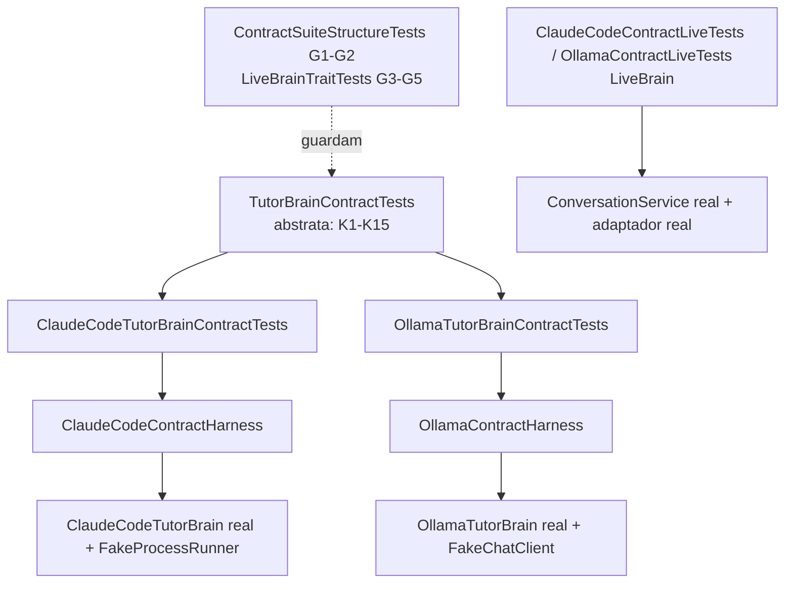

# US-008 — Suíte de contrato do ITutorBrain

**Sprint:** 1 · **Branch:** feature/US-008_contrato-itutorbrain · **Status:** Concluída em 2026-10-23 (merge em `develop` pelo orquestrador)
**Regras:** RN-BRAIN01, RN-BRAIN03 (da US); RN-BRAIN04, RN-BRAIN07, RN-BRAIN09 (conferidas pelos testes, sem mudança); ARCHITECTURE §10 · **ADRs:** nenhum novo; ADR-005, ADR-006, ADR-007 e ADR-009 consumidos (os pontos "a suíte de contrato confere" ficam fechados)

## O que mudou para o usuário

Nada visível no aplicativo: `src/` não foi alterado. A mudança é de garantia: trocar `Brain:Provider` entre `ClaudeCode` e `Ollama` não muda o comportamento que a aplicação vê, e isso agora é verificado por uma suíte única executada contra os dois provedores. Também há testes opcionais contra os provedores reais (`LiveBrain`), fora da suíte padrão.

## Como funciona (resumo técnico)

Toda a US é código de teste em `tests/EnglishTutor.Infrastructure.Tests/Contract/`.

- **Bancada por provedor** (`BrainContractHarness`): abstrai as portas de falha diferentes (`IProcessRunner` e `IChatClient`) para o corpo dos testes ser único. Cada bancada enfileira resposta, travamento (`EnqueueHang`), inalcançável, avança o relógio e expõe o que foi enviado ao modelo (`Sent`).
- **Suíte abstrata** com 16 métodos (23 casos por provedor): nome canônico; mesmo `TutorReply` nos modos `JsonSchema` e `Tags`; 1 e 2 perguntas aceitas, 0 e 3 rejeitadas; saída inutilizável vira `InvalidOutput` com `RawText` exato; janela completa e em ordem com instância nova; sem estado entre chamadas; `Timeout` nos dois lados do limite; inalcançável vira `BrainException` do tipo do provedor (`CliNotFound` no Claude Code, `Unknown` no Ollama, ADR-009); cancelamento propaga; retentativa única pelo `ConversationService` (RN-BRAIN04).
- **Subclasses** só implementam `CreateHarness`; não declaram testes.
- **Guardas por reflexão:** G1 (todo provedor de `BrainProviders.All` tem subclasse concreta), G2 (só a base declara testes), G3 a G5 (o trait `LiveBrain` fica exatamente nas classes `*LiveTests` e nunca na suíte de contrato).
- **Variante live:** classes `<Provedor>ContractLiveTests`, separadas da suíte (os fakes simulam falhas que o modelo real não produz sob demanda). Dois turnos pelo `ConversationService` real; asserções comuns em `Support/LiveContractChecks`.
- **Fora do contrato:** `NotAuthenticated`, `UsageLimitReached`, argumentos do processo, `format` do Ollama e o `FallbackTutorBrain` (cada um tem testes próprios).

## Configuração nova (chaves do appsettings, valores padrão)

Nenhuma.

## Testes e evidências (2026-10-23, código em `b0239e8`)

- Suíte sem `LiveBrain`: **487 testes** verdes (Core 155, Infrastructure 261, Console 71; eram 435 na US-007). Infrastructure.Tests em 0,4 s.
- Por tipo: 46 de contrato (23 por provedor), 6 de guarda por reflexão (G1 com 2 casos, G2 a G5), 2 live (`LiveBrain`, fora da suíte padrão).
- Cobertura de linhas do `EnglishTutor.Core`: **100%** no relatório mesclado (`reportgenerator`); solução 90,5%; Infrastructure 86,6%; Console 95,4%. `src/` não mudou.
- D8 (live, `claude` autenticado e Ollama com `qwen2.5:14b-instruct-q4_K_M`): 2 testes verdes em 3 rodadas seguidas (14 s, 11 s, 10 s). Critério: zero respostas cruas em 2 turnos com a retentativa única valendo. O Revisor não reproduziu o D8 (depende do ambiente).
- D7: `--list-tests | grep -c ContractLiveTests` dá 0 em `Category!=LiveBrain` e 2 em `Category=LiveBrain`.
- D4 limpo, D11 (caracteres invisíveis) 0, D12 (`src/` intocado) vazio, `git status` limpo.
- Red por mutação (os testes caracterizam adaptadores prontos e nascem verdes): mutações aplicadas em `src/` depois do commit e desfeitas pela edição inversa, para K1 a K15 nos dois provedores e para G2 a G5; cada uma falhou só os testes esperados.
- Revisão (`tasks/US-008/review.md`): APROVADO, 0 bloqueantes. S1 (evidências em uma linha, sem a saída das mutações) não aplicada.

## Decisões e trade-offs

- **Sem ADR novo:** a estrutura (abstrata + uma subclasse por provedor + variante live) já estava na ARCHITECTURE §10; só a redação da linha "Live" e a skill `tdd-dotnet` foram ajustadas.
- **Variante live separada da suíte:** os fakes simulam Timeout, resposta inválida e inalcançável, que o modelo real não produz sob demanda. Reverte a ideia inicial de "mesmas classes com trait".
- **Contrato cobre só o que os dois provedores prometem:** Timeout e inalcançável entram (com o `Kind` de cada um); `NotAuthenticated` e `UsageLimitReached` ficam nos testes do Claude Code. A mensagem é conferida só pela chave de configuração que cita.
- **Resume do Claude Code (ADR-007):** a janela completa é conferida com instância nova; o pedido que estende o anterior confere o resultado, não o texto enviado.
- **K10 mudou de técnica durante a execução:** a mutação prescrita (remover `&& !ct.IsCancellationRequested`) não falhava o teste original. A bancada ganhou `EnqueueHang(Action? onCancelled)`, que avança o relógio depois do cancelamento do chamador; assim o teste só passa se o chamador vencer o timeout. Registrado na §12 do plano antes do commit.
- **Nomes dos testes live** evitam a subcadeia `ContractTests`, para o D5 da spec não arrastá-los.

## Limitações conhecidas / próximos passos

- **L1:** os testes live não exigem que a retentativa tenha sido usada; a prova do mecanismo é o K15 (fakes). A taxa de retentativa fica para a US-009 (`eval`).
- **L2:** o contrato não cobre `NotAuthenticated`, `UsageLimitReached`, argumentos do processo nem o `format` do Ollama; continuam nos testes dos adaptadores.
- **L3:** o K12 usa tipos diferentes por provedor (`CliNotFound` × `Unknown`). Se surgir um `ProviderUnavailable`, muda a propriedade `UnavailableKind` da bancada em um ponto só.
- **Risco de oscilação do `LiveBrain`:** se L1 ou L2 ficarem vermelhos por variação do modelo, quem decide (tolerância, modelo ou asserção) é o usuário, com registro prévio na spec.
- Próxima US da sprint: US-009 (`eval` comparativo).
