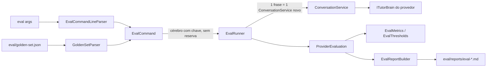

# US-009 — Avaliação comparativa dos cérebros

**Sprint:** 1 · **Branch:** feature/US-009_avaliacao-comparativa-cerebros · **Status:** Concluída em 2026-10-23 (merge em `develop` pelo orquestrador, depois da revisão do `golden-set.json` pelo usuário: ver "Pendências do usuário")
**Regras:** PRODUCT (métricas de sucesso); RN-BRAIN04, RN-BRAIN07 (tocadas, sem mudança); RN-FEED01, RN-FEED02 (consumidas) · **ADRs:** ADR-011 (novo, Aceito); ADR-006 e ADR-010 consumidos; ARCHITECTURE §6.6

## O que mudou para o usuário

Existe um comando novo, `EnglishTutor.Console eval`, que compara os cérebros com um conjunto fixo de 32 frases com erro conhecido (`eval/golden-set.json`):

```powershell
dotnet run --project src/EnglishTutor.Console -- eval --providers ClaudeCode,Ollama
```

Para cada provedor, a tela mostra uma tabela de resumo e grava um relatório markdown em `eval/reports/eval-<aaaaMMdd-HHmmss>.md` (UTC, ignorado pelo Git) com:

- porcentagem de correções esperadas encontradas;
- porcentagem de respostas no formato válido **sem** retentativa e, à parte, **com** a retentativa única (RN-BRAIN04);
- latência média e p95 do turno;
- a **nota mínima** (`met` / `not met`): correções encontradas >= 80% e formato sem retentativa >= 90%. É essa nota que as US de cérebro seguintes usam na DoD (`eval --providers <provedor>` e a linha do provedor diz `met`);
- uma tabela por provedor com o resultado de cada frase e uma coluna `Note` (`retry used`, `raw fallback after retry` ou a mensagem da falha).

Provedor fora do ar (por exemplo, Ollama parado) aparece como `unavailable`, com o motivo, e os outros provedores seguem válidos. Argumentos inválidos ou golden set ausente/inválido terminam com código 2, mensagem na saída de erro que diz o que está errado e o que se espera, e nenhum relatório. O guia do formato do arquivo, de como o critério casa e de como ampliar `accepted` está em `eval/README.md`.

## Como funciona (resumo técnico)

A lógica é regra de negócio e mora no Core (`EnglishTutor.Core/Evaluation`, só BCL); o Console só orquestra; a Infrastructure não mudou (ADR-011).



- **Critério de "correção encontrada"** (ADR-011 §3): algum `Corrected` da resposta contém, como palavras lado a lado (minúsculas, sem pontuação nas bordas, aspas tipográficas normalizadas), uma das formas de `accepted`. Só mede cobertura: correção a mais não é penalizada, e `Original` e `Explanation` não entram.
- **Execução por provedor:** cada frase vai sozinha, com janela vazia e modo `free-conversation`. A latência inclui a retentativa. Se a **primeira** frase falha com `BrainException`, o provedor é `unavailable` e as demais não rodam; falha em frase posterior vira erro daquela frase (fica fora da latência e dentro das taxas). `OperationCanceledException` sempre propaga.
- **Cérebro avaliado:** o `ITutorBrain` com chave do provedor (ADR-010), sem `FallbackTutorBrain`, mesmo com `Brain:FallbackProvider` configurado.
- **Métricas:** p95 pelo posto mais próximo, com inteiros (`(95 * n + 99) / 100`); média por soma de ticks dividida pela quantidade.
- **Golden set:** `GoldenSetParser` coleta todos os erros (G1 a G12), cada um em inglês dizendo o que está errado e o que se espera. `reviewedBy` vazio vale "revisão pendente" e aparece no relatório.
- **Despacho:** `EnglishTutorApp` escolhe entre chat e `eval` só pelo primeiro argumento (`eval`, sem diferenciar maiúsculas), depois de a partida validar a configuração. `--providers` aceita lista com vírgula ou tokens separados (o Windows PowerShell 5.1 passa `ClaudeCode,Ollama` sem aspas como dois argumentos).
- **Logs:** eventos 1006 (`EvalProviderEvaluated`) e 1007 (`EvalReportSaved`); o texto das frases não é logado.

## Configuração nova (chaves do appsettings, valores padrão)

Nenhuma chave nova no `appsettings.json`. O comando tem três opções de linha de comando:

| Opção | Padrão |
|---|---|
| `--providers <nome[,nome...]>` | todos os provedores de `BrainProviders.All` |
| `--golden-set <arquivo>` | `eval/golden-set.json` |
| `--reports-dir <pasta>` | `eval/reports` |

Códigos de saída: 0 quando o relatório é gravado (mesmo com `unavailable` ou `not met`); 2 para argumentos ou golden set inválidos; 1 para falha ao gravar o relatório.

## Testes e evidências (2026-10-23, código em `63f43de`)

- Suíte sem `LiveBrain`: **624 testes** verdes (Core 263, Infrastructure 261, Console 100), cada projeto em menos de 1 s. Novos: **137** (Core 155 para 263, +108; Console 71 para 100, +29), igual ao plano.
- Cenários BDD com teste: 5 de 5 (rodar o golden set, provedor indisponível, nota mínima, argumentos inválidos, golden set inválido). Suítes novas: `EvalTextTests`, `CorrectionMatcherTests`, `GoldenSetParserTests`, `EvalMetricsTests`, `EvalRunnerTests`, `EvalReportBuilderTests`, `GoldenSetFileTests` (Core) e `EvalCommandLineParserTests`, `EvalCommandTests` (Console). Relógio falso (`FakeTimeProvider`); nenhum teste faz espera real.
- Cobertura de linhas do `EnglishTutor.Core`: **98,3%** (relatório mesclado; total 91,7%). `Evaluation/`: 100% nas classes pequenas, `EvalRunner` 94,8%, `GoldenSetParser` 93,4%.
- D5/D6 (Windows PowerShell 5.1, 3 rodadas seguidas do comando completo, `claude` autenticado, Ollama com `qwen2.5:14b-instruct-q4_K_M`): ClaudeCode `met` nas três, com correções de 96,9%, 93,8% e 100% e formato sem retentativa de 100%; latência média de 5,6 a 6,7 s e p95 de 6,7 a 6,8 s. Ollama (informativo): 56,2%, 59,4% e 62,5% das correções, formato sem retentativa de 100%, 96,9% e 100%; `not met` nas três.
- D8 a D11: `unavailable` com `exit=0` para Ollama inalcançável; cabeçalho do chat intacto com pipe; `Unknown provider 'Inexistente'. Accepted values: ClaudeCode, Ollama.` com `exit=2`; `Golden set not found` nos dois formatos de `--providers`, com `exit=2`.
- D1, D4, D12 (`src/EnglishTutor.Infrastructure` sem diff) e D13 (caracteres invisíveis: 0) limpos.
- Revisão (`tasks/US-009/review.md`): APROVADO, 0 bloqueantes, 3 sugestões. O Revisor reproduziu D1 a D4 e D13; D5 a D12 são evidência do Executor, não reproduzida.

## Decisões e trade-offs

- **ADR-011 (Aceito):** a lógica do `eval` mora no Core, e não no Console nem num projeto `EnglishTutor.Eval`; o critério de correção é por palavras de `accepted` (sem juiz por outro modelo). Alternativas descartadas estão no ADR (juiz por modelo, casar pelo `original` da resposta, igualdade exata do `Corrected`, `BrainFactory.Create(provider)` público).
- **Só o formato sem retentativa entra na nota** (PRODUCT: "sem retentativa"); a taxa com retentativa é informativa. Fecha a pendência da US-008 (L1) de medir a taxa de retentativa.
- **Escolhas de forma do Executor registradas na §12 do plano antes dos `feat`:** ordem dos erros do parser, mensagens para elemento que não é objeto, percentual com total zero exibido como `-`, `Generated (UTC)` e nome do arquivo lidos no início do comando (o nome não depende do tempo que os provedores levam).
- **`TimeProvider.System`** passou a ser registrado em `AddEnglishTutorCore` (`TryAddSingleton`), porque o `EvalRunner` o recebe por injeção.
- **Nota mínima só para o provedor principal:** o Ollama não tem limiar nesta US.

## Limitações conhecidas / próximos passos

Pendências do usuário antes do merge em `develop`:

- **S3 — revisar o golden set.** `eval/golden-set.json` continua com `"reviewedBy": ""`. O usuário precisa revisar as 32 frases (erro e formas aceitas) e preencher o campo. Até lá, **D6 e D7 são provisórios**: o `git grep -n -F '"reviewedBy": ""' -- eval/golden-set.json` ainda acha a linha 2 (código 0); depois do preenchimento deve sair sem linha (código 1). Se a revisão mudar frases ou `accepted`, o D6 deve ser repetido, pois a régua muda. O Documentador não alterou o arquivo.

Limites conhecidos:

- **S2 — Ollama abaixo da meta.** O Ollama ficou em 56 a 63% das correções esperadas, abaixo dos 80% do PRODUCT (`not met`). Não há limiar para o Ollama nesta US, então isso não bloqueia. A US que ajustar o modelo local, o prompt ou o `accepted` deve registrar a decisão na spec **antes** (plano §7).
- **S1 — ramos do `GoldenSetParser` sem teste.** Elemento de `sentences` ou de `expected` que não é objeto, e item de `accepted` não textual, produzem mensagem própria mas não têm teste (cobertura da classe: 93,4%). Aceito como limite nesta US (plano §11 e §12); um teste por ramo, ou a confirmação da mensagem como comportamento aceito, fica para a US que mexer no parser.
- **L1:** o critério mede só cobertura; correção errada ou a mais não é penalizada (RN-FEED02 limita a 2 por resposta).
- **L2:** paráfrase correta fora de `accepted` conta como não encontrada; o relatório detalha cada frase para o usuário ampliar `accepted` (mudança de dados, registrada em `reviewedBy`).
- **L3:** a indisponibilidade é decidida pela primeira frase (um `Timeout` nela marca o provedor inteiro como `unavailable`).
- **L4:** "formato válido" herda a tolerância de 1 a 2 perguntas (RN-FEED01).
- **L5:** duas rodadas no mesmo segundo sobrescrevem o relatório.
- **L6:** com 32 frases, o p95 é a 31ª medida; latência é só informativa. A meta de latência do PRODUCT é fim a fim (inclui STT e TTS) e exige amostra maior.
- **ADR-002** segue Proposto: o `eval` não compara os modos JSON Schema e tags, então a confirmação por medição prevista no ADR continua em aberto.
