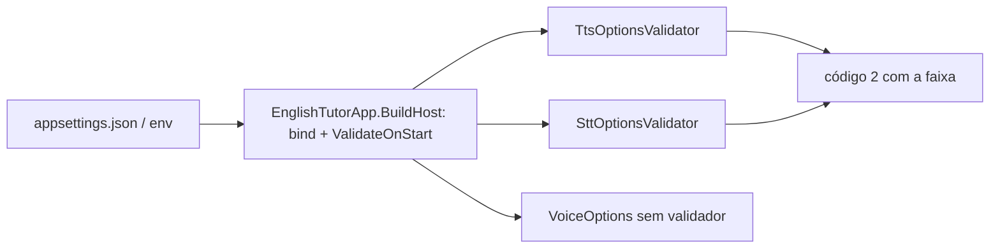

# US-010 — Portas de voz e áudio no Core, com configuração validada

**Sprint:** 2 · **Branch:** feature/US-010_portas-voz-audio-config · **Status:** Concluída em 2026-10-26
**Regras:** RN-TTS01, RN-TTS02, RN-STT01 (só valores e faixa; nenhuma regra muda); ARCHITECTURE §2 (R1, R4), §3, §4, §7, §10 · **ADRs:** ADR-004 (consumido; nenhum ADR novo)

## O que mudou para o usuário

Nada no chat: ele continua igual, com voz ligada ou desligada. A US prepara o terreno para as US de voz (011, 013, 014):

- O `appsettings.json` distribuído passa a declarar as chaves de voz com os padrões: `Voice:Enabled` = `false`, `Tts:Speed` = `1.0`, `Stt:LowConfidenceThreshold` = `0.6`.
- Valor fora da faixa encerra o app na partida com código 2 e uma mensagem que diz a faixa. Exemplo: `Tts:Speed must be between 0.5 and 1.5 (found 3.0). Expected a playback speed multiplier; the default is 1.0.`
- Se `Tts` e `Stt` estiverem inválidos ao mesmo tempo, o console lista as duas falhas (AP-039).
- O filtro padrão de testes passou a ser `Category!=LiveBrain&Category!=LiveVoice` (hooks, CI, README, agentes e skills sincronizados).

## Como funciona (resumo técnico)

Tudo no Core, só BCL (R1). A validação de faixa fica no Core, e não nos adaptadores (R4).

- `Core/Audio`: `AudioClip` (PCM mono, float32 em [-1, 1], `SampleRate`, `Samples`, `Duration`), `IAudioRecorder`, `IAudioPlayer`. O construtor rejeita taxa <= 0 (`ArgumentOutOfRangeException`) e clipe sem amostras (`ArgumentException`), com mensagens que dizem o que se espera. `SampleRate` e `Samples` são somente leitura, então `with` não contorna a validação; a igualdade do `record` compara a referência do buffer, não o conteúdo.
- `Core/Speech`: `ISpeechToText`, `Transcript`, `TranscribedWord`, `ITextToSpeech` (como ARCHITECTURE §4, sem validação nos tipos de transcrição), mais `TtsOptions`/`TtsOptionsValidator`, `SttOptions`/`SttOptionsValidator` e `VoiceOptions`.
- `AddEnglishTutorCore` registra os dois validadores; o bind das seções `Tts`, `Stt` e `Voice` fica no composition root (ADR-004).
- Números nas mensagens usam `CultureInfo.InvariantCulture` (formato `0.0##`), com teste em pt-BR.
- Fakes de teste em `Core.Tests/Fakes`: `FakeSpeechToText`, `FakeTextToSpeech`, `FakeAudioRecorder`, `FakeAudioPlayer`.

## Configuração nova (chaves do appsettings, valores padrão)

| Chave | Padrão | Faixa |
|---|---|---|
| `Voice:Enabled` | `false` | booleano; ninguém lê esta chave ainda (a US-011 passa a ler) |
| `Tts:Speed` | `1.0` | 0.5 a 1.5, inclusivos; NaN rejeitado |
| `Stt:LowConfidenceThreshold` | `0.6` | 0 a 1, inclusivos; NaN rejeitado |

## Testes e evidências (2026-10-26, código em `a66739b`)

- Suíte sem `LiveBrain` e `LiveVoice`: **672 testes** verdes (Core 306, Infrastructure 261, Console 105), cada projeto em menos de 1 s, sem rede, GPU, microfone ou alto-falante.
- Cenários BDD com teste: 4 de 4 (portas existem; opções inválidas; valores padrão; clipe inválido). Suítes novas: `AudioClipTests`, `VoicePortsTests`, `TtsOptionsTests`, `TtsOptionsValidatorTests`, `SttOptionsTests`, `SttOptionsValidatorTests`, `VoiceOptionsTests`, `FakeVoicePortsTests`; ampliadas `CoreServiceCollectionExtensionsTests`, `EnglishTutorAppTests` e `AppSettingsTests` (com o `OptionsProbe` de suporte).
- Cobertura de linhas do `EnglishTutor.Core`: **98,4%** (relatório mesclado, `reportgenerator`); total da solução 91,9%; `AudioClip` 100%.
- D6 e D7 (Windows PowerShell 5.1): `Tts__Speed=3.0` dá a mensagem de faixa e `exit=2`; `"/quit" | dotnet run` mostra o cabeçalho e `exit=0` (evidência do Executor, não reproduzida pelo Revisor).
- D8: o filtro antigo não aparece mais fora dos arquivos de histórico; D10 (caracteres invisíveis): 0.
- Red dos testes que nascem verdes provado por mutação (padrões 1.0, 0.6 e `false`; limites 1.5 e 1; `Voice:Enabled`), revertidas.
- Revisão (`tasks/US-010/review.md`): APROVADO, 0 bloqueantes, 2 sugestões.

Nomes reais dos testes que divergem do mapa da §4 do plano (o plano não foi reescrito; vale esta lista):

| Plano (§4) | Real |
|---|---|
| `AudioClipTests.Constructor_WhenThereAreNoSamples_ThrowsWithExpectation` como Theory (vazio e `default`) | `Constructor_WhenThereAreNoSamples_ThrowsWithExpectation` (Fact, array vazio) e `Constructor_WhenSamplesAreDefault_ThrowsWithExpectation` (Fact, `default`) |
| caso de 1 amostra dentro de `Constructor_WithSamples_ExposesSampleRateSamplesAndDuration` | `Constructor_WithSingleSample_IsValid` (Fact) |
| `VoicePortsTests` com `typeof` | nomes completos em string e `_core.GetType(...)`, para o Red falhar por comportamento |

## Decisões e trade-offs

- **Sem ADR novo:** contratos já estavam em ARCHITECTURE §4 e a validação segue o ADR-004.
- **`AudioClip` mono float32 em [-1, 1] com `ReadOnlyMemory<float>`:** o adaptador converte de/para PCM16. Descartados `byte[]` PCM16, canais (YAGNI) e validar `Speed` no adaptador Piper (violaria R4).
- **Faixa do `Stt:LowConfidenceThreshold` = 0 a 1** (confiança é probabilidade); o PRODUCT só fixava o padrão.
- **`Voice:Enabled` não é lido por ninguém:** chat idêntico com `true` ou `false`.
- **`appsettings.json` declara as três seções,** com teste de igualdade com os padrões das classes.
- **Filtro de teste padrão** acrescenta `LiveVoice` em todo lugar executável e documentado; `&` chegou ao `dotnet test` pelos hooks sem ajuste.

## Limitações conhecidas / próximos passos

- `Voice:Enabled` com texto não booleano (ex.: `abc`) herda o binder: código 1, "unexpected error", sem teste (P6).
- `Transcript` e `TranscribedWord` sem validação (confiança em [0, 1]); a US-014 decide.
- `Tts:Speed` só é lido na partida; `/speed` em sessão fica para a US-012.
- Sem fake com `Throws` (YAGNI); a US-011 acrescenta se precisar.
- Próximas: US-011 (Piper), US-013 (gravação), US-014 (Whisper).
