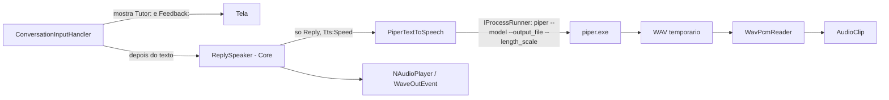

# US-011 — O professor fala o `reply` (Piper)

**Sprint:** 2 · **Branch:** feature/US-011_professor-fala-reply-piper · **Status:** Concluída em 2026-10-26
**Regras:** RN-TTS01 (e RN-TTS02 só pelo valor padrão de `Tts:Speed`); ARCHITECTURE §1, §3, §4, §5 (passo 6), §7 · **ADRs:** ADR-012 (Aceito), ADR-004, ADR-008

## O que mudou para o usuário

Com `Voice:Enabled=true`, o console mostra o `reply` e o feedback do turno e só então fala o `reply` com o Piper (voz `en_US-lessac-medium`). O feedback e a resposta crua (`IsRawFallback`) nunca são falados. A próxima entrada só é lida depois do fim do áudio.

- Piper ou voz ausentes na partida: a saída de erro mostra o que falta (`Missing: <caminho completo>`) e como baixar; o chat segue por texto.
- Síntese ou reprodução falhou num turno: a saída de erro mostra `Audio failed: the reply is shown as text only. The session continues.` e a sessão continua.
- Ctrl+C durante a síntese ou a reprodução: para tudo, sem mensagem, código de saída 0.
- Com `Voice:Enabled=false` o chat é idêntico ao de antes. O cabeçalho e o `/help` não mudaram.

D7 (manual, feita pelo usuário): a voz `en_US-lessac-medium` está boa. Um aprimoramento fica para o futuro, só se necessário: a voz britânica `en_GB-alan-medium` (já baixada para teste via variável de ambiente), um possível efeito estilo assistente pessoal aplicado depois da síntese e velocidade perto de 0,85 por `Tts:Speed`. Por isso a Kokoro continua no backlog.

## Como funciona (resumo técnico)

- `ReplySpeaker` (Core, R4): `Skipped` para `IsRawFallback` ou texto em branco; `Spoken` quando sintetiza e toca; `Failed` para qualquer exceção do TTS ou do player, logada (Warning 3101, `Stage` = `synthesis`/`playback`). `OperationCanceledException` sempre propaga. Logs 3100 (tempos e nº de caracteres, nunca o texto) e 3102. `ConversationService` não mudou.
- `PiperTextToSpeech`: argumentos em lista, `length_scale` = 1/velocidade (cultura invariável), quebras de linha achatadas em espaço, WAV temporário apagado no `finally`, tempo máximo próprio (`TimeoutException` só com o chamador vivo), `ExitCode` diferente de 0 e arquivo ausente com mensagem que diz o que se espera. `FileName`, `--model` e `--output_file` são caminhos completos (`Path.GetFullPath`), porque o Piper roda com `WorkingDirectory` na pasta do executável.
- `WavPcmReader` lê RIFF/WAVE PCM 16 bits mono (pula chunks extras, tolera `data` com tamanho maior que o arquivo).
- `PiperVoiceOutputCheck` (porta `IVoiceOutputCheck`) confere executável, modelo e `<modelo>.json` na partida; `EnglishTutorApp` só o resolve com `Voice:Enabled=true` (logs AppLog 1008/1009).
- `NAudioPlayer` (`NAudio.WinMM` 2.2.1): o dispositivo nasce e morre dentro do `PlayAsync`; o construtor não toca WinMM, por isso o teste de DI roda no CI.

## Configuração nova (chaves do appsettings, valores padrão)

| Chave | Padrão | Faixa |
|---|---|---|
| `Tts:Piper:ExecutablePath` | `models/piper/piper.exe` | não vazio |
| `Tts:Piper:ModelPath` | `models/piper/en_US-lessac-medium.onnx` | não vazio; o `.onnx.json` fica ao lado |
| `Tts:Piper:TimeoutSeconds` | `30` | 1 a 300 |

Caminhos relativos valem a partir do diretório atual (`dotnet run` na raiz do repositório). `models/` é ignorado pelo Git. `Voice:Enabled` (padrão `false`) e `Tts:Speed` já existiam (US-010).

## Testes e evidências

Código em `260f54d`/`ea21313`, 2026-10-26.

- Suíte sem `LiveBrain` e `LiveVoice`: **764 testes** verdes (Core 322, Infrastructure 322, Console 120), cada projeto em menos de 1 s, sem rede, GPU, microfone ou alto-falante.
- Cenários BDD com teste: 6 de 6 (falar só o reply; texto antes do áudio; resposta crua; Piper ausente; falha da síntese; Ctrl+C).
- Cobertura de linhas (relatório mesclado, `reportgenerator`, rodada 1 da revisão): `EnglishTutor.Core` **98,2%**; total da solução 91,3%. `NAudioPlayer` 0% (limite aceito, coberto só pela D6).
- D6 (`LiveVoice`, Piper e alto-falante reais, caminhos relativos padrão): 2 aprovados; síntese de 555 ms para uma frase de duas sentenças.
- D5: 56 testes com o filtro `FullyQualifiedName~Tts&Category!=LiveBrain&Category!=LiveVoice`; o filtro antigo listaria 58, incluindo `PiperLiveVoiceTests`.
- Red por mutação provado nos testes que nasceram verdes (ver `plan.md` §11).
- Revisão (`tasks/US-011/review.md`): rodadas 1 e 2 APROVADAS, 0 bloqueantes. A S1 da rodada 2 foi aplicada depois, só em teste (`260f54d`).

## Decisões e trade-offs

- **ADR-012:** o Piper roda por processo a cada turno (WAV temporário) e o `ReplySpeaker` mora no Core, chamado pela interface depois de mostrar o texto; falar dentro do `ConversationService` atrasaria o texto.
- Bug da D7: caminho relativo com `WorkingDirectory` diferente do diretório atual quebrava toda síntese (`Piper exited with code -1073740791`). Corrigido com `Path.GetFullPath`; o teste live passou a usar os padrões relativos reais.
- Aviso de voz ausente na saída de erro, como `BrainFailed`; o cabeçalho não ganhou linha de voz (entra na US-016).
- `WavPcmReader` pública (o projeto não usa `InternalsVisibleTo`).

## Limitações conhecidas / próximos passos

- Cada turno recarrega a voz no Piper: latência de síntese medida só como registro; pesa na US-016/US-017 e, se necessário, na Fase 6 (processo persistente).
- Dispositivo de áudio ausente só falha no primeiro turno (a partida só olha arquivos).
- `Tts:Speed` é o valor da partida; a US-012 torna a velocidade ajustável na sessão e o `ReplySpeakerTests` continua como contrato.
- Aprimoramento da voz (voz britânica, efeito pós-síntese, velocidade perto de 0,85) fica para depois, só se necessário.
- `NAudioPlayer` sem teste unitário.
