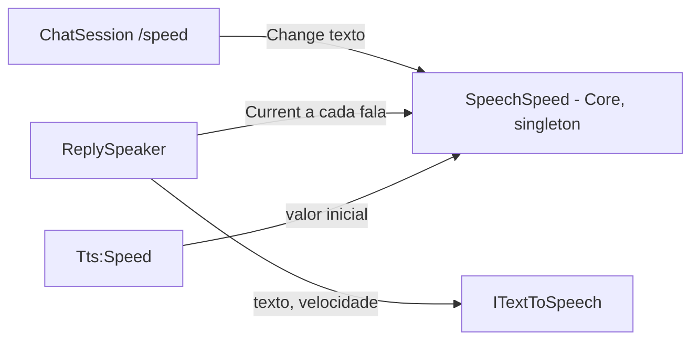

# US-012 — Velocidade da fala configurável e ajustável na sessão

**Sprint:** 2 · **Branch:** feature/US-012_velocidade-da-fala · **Status:** Concluída em 2026-10-27 (D6 e D11, manuais, pendentes do usuário)
**Regras:** RN-TTS02, RN-CONV06 · **ADRs:** ADR-012 (consequência "a velocidade vira valor mutável da sessão"); nenhum ADR novo

## O que mudou para o usuário

`Tts:Speed` passa a ser só o valor inicial da velocidade da sessão. No console:

- `/speed 1.2` muda a velocidade; a saída contém `Speed set to 1.2x` e a próxima resposta já sai nessa velocidade.
- `/speed` sozinho mostra `Current speed: 1.0x (accepted range: 0.5 to 1.5). Example: /speed 1.2.`
- Valor fora de 0.5 a 1.5 (limites inclusivos) ou que não é número (`fast`, `1,2`, `NaN`) é recusado com mensagem que diz a faixa e a velocidade que continua valendo (`The speed stays at 1.2x.`). Só o ponto é separador decimal. `+1.2` vale 1.2.
- `/help` lista `/speed - Show or change the speaking speed (0.5 to 1.5)`.
- Funciona igual com `Voice:Enabled=false` ou Piper ausente (só não há fala para ajustar). O cabeçalho não mudou.
- A velocidade da sessão não é persistida: ao reiniciar volta ao `Tts:Speed`.

## Como funciona (resumo técnico)

- `SpeechSpeed` (Core/Speech): guarda `Current`; `Change(string)` faz parse com cultura invariável (`float.TryParse`, sem expoente nem milhar, `float.IsFinite` explícito) e confere a faixa de `TtsOptions` (limites inclusivos). Só `Applied` altera `Current`. `Format` mostra de 1 a 3 casas (`1.0`, `0.85`, `0.833`). Registrado como singleton por `AddEnglishTutorCore`.
- `SpeedChange`/`SpeedChangeStatus` (`Applied`, `NotANumber`, `OutOfRange`) devolvem o resultado e a velocidade em vigor.
- `ReplySpeaker` troca `IOptions<TtsOptions>` por `SpeechSpeed` e lê `Current` a cada `SpeakAsync` (nunca guarda). O contrato com `ITextToSpeech.SynthesizeAsync(texto, velocidade, ct)` não mudou.
- `LocalCommandParser` reconhece `/speed` sem diferenciar maiúsculas; `ChatSession` trata em `ChangeSpeedAsync` e nada vai ao cérebro (RN-CONV06). Mensagens na saída padrão, código de saída 0, como `/mode`.
- `ARCHITECTURE.md` §3 e §7 e a spec da Sprint 2 foram atualizadas antes do código.

## Configuração nova (chaves do appsettings, valores padrão)

Nenhuma chave nova. `Tts:Speed` (0.5 a 1.5, padrão 1.0) passa a ser o valor inicial da velocidade da sessão.

## Testes e evidências

Suíte unitária (sem `LiveBrain`/`LiveVoice`): 822 aprovados, 0 falhas (Core 359, Infrastructure 322, Console 141), cada projeto em menos de 1 s.

- Testes novos principais: `SpeechSpeedTests` (parse, faixa nos dois lados dos limites, `NaN`/`Infinity`, formato, pt-BR), `SpeedCommandTests` (5 métodos), `SpeedAppTests` (4 métodos, ponta a ponta no composition root), mais parser, registro no DI, `/help` e `ReplySpeakerTests`.
- Filtro D5 (`FullyQualifiedName~Speed`, sem `Live*`): Core 49, Infrastructure 8, Console 22 aprovados.
- Cobertura (relatório mesclado com reportgenerator): Core 98,2% de linhas; total da solução 91,4% (Console 95,4%, Infrastructure 86,4%); `SpeechSpeed` e `ReplySpeaker` 100%. O revisor obteve 92,6% no total da solução na própria execução; a diferença não afeta o limite de 80% do Core.
- Build 0 avisos; `dotnet format --verify-no-changes` sem diferenças; D8 (Windows PowerShell 5.1 com pipe, BOM) e D9/D10 verdes. D7: o corpo de `SpeakAsync_WhenSpeedIsConfigured_PassesItToTts` não mudou.
- Revisão: aprovada, 0 bloqueantes.
- **Pendentes do usuário (sem resultado registrado):**
  - **D6** — prova manual de voz com Piper real: `Voice:Enabled=true`, `/speed 0.7`, um turno, `/speed 1.4`, outro turno, e confirmar a diferença audível. Nenhum teste prova o efeito no ouvido.
  - **D11** — `git status --short` depois da D6, sem arquivos de `models/`, `*.wav` nem `appsettings.*.local.json`.

## Decisões e trade-offs

- A regra da faixa mora no Core (`SpeechSpeed`), não na casca nem no adaptador (R4). Sem ADR novo: é a consequência já anotada no ADR-012.
- Alternativas descartadas: estado mutável no `ReplySpeaker` (deixaria `/speed` sem dono com voz desligada); mutar `IOptions<TtsOptions>.Value` (esconde estado de sessão em configuração e pula a faixa); guardar o número no `ChatSession` (regra de negócio na casca).
- `/speed` funciona sem voz, para a US-016 ("como no chat por texto").
- Sinal positivo aceito (`+1.2` = 1.2); vírgula decimal recusada de propósito.

## Limitações conhecidas / próximos passos

- A velocidade não é persistida (persistência é da Sprint 3, RN-PERS).
- Acesso sem sincronização a `SpeechSpeed.Current`: seguro no laço sequencial atual (`float` é atômico); uma interface com várias threads precisa revisar.
- Mais de 3 casas são aceitas; só a mensagem arredonda (`/speed 0.8333` mostra `0.833x`), o áudio usa o valor digitado.
- D6 e D11 pendentes; devem ser feitas pelo usuário antes do merge em `develop`.
- Sem log da mudança de velocidade nem linha de velocidade no cabeçalho (só se o usuário pedir).
